# IrrigaTrace — Night Field Observatory

> **Audit, Replay, and Traceability Framework for AI Irrigation Decisions**  
> **Course:** Object-Oriented Software Engineering (OOSE Lab, Semester 5)  
> **Project Code:** KJS-AGR-01 · Somaiya School of Engineering  
> **Aesthetic Theme:** Nocturne Canopy Observatory (Inspired by `design/reference/beanmachine-reference.png`)

[](https://github.com/Demmonics/irrigatrace)
[](LICENSE)
[](https://fastapi.tiangolo.com)
[](https://nextjs.org)
[](https://www.python.org/)
[](docs/oose/EXP8_STD.md)

---

## 1. Quick Start & Execution

### Prerequisites
- Python 3.12+ / 3.13+
- Node.js v20+ / v24+
- Ollama (running locally on `http://localhost:11434` with `qwen2.5:3b` pulled)

### Run Commands
```bash
# 1. Run Complete Automated Test Suite (24/24 passing)
make test

# 2. Run LLM Grounding & NumberConsistencyValidator Evaluation (20/20 passing)
make llm-eval

# 3. Run the 7-Minute Evaluator Demo Script
make demo

# 4. Start Full Development Environment (FastAPI Backend + Next.js Web App)
make dev
```
* **Web Application:** `http://localhost:3000`
* **FastAPI REST API Docs:** `http://localhost:8000/docs`
* **API Health Check:** `http://localhost:8000/api/health`

---

## 2. System Architecture & Core Invariants

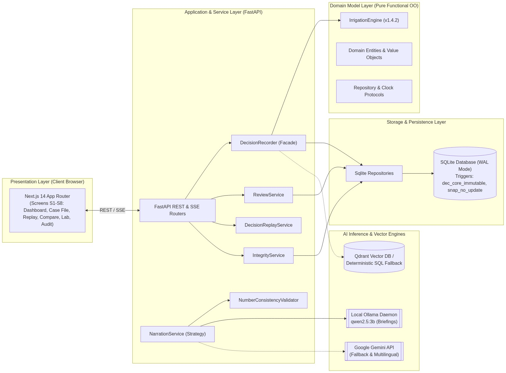

IrrigaTrace implements an object-oriented Clean Architecture governed by 8 immutable invariants:
1. **The Original Recommendation is Never Overwritten:** Human review adjustments are stored as separate first-class entities (`HumanReview`). SQLite database-level triggers (`dec_core_immutable`, `snap_no_update`) abort any `UPDATE` or `DELETE` attempt at the storage engine level.
2. **Append-Only Cryptographic Audit:** Every lifecycle event produces a SHA-256 block linked sequentially:
   $$H_i = \text{SHA-256}(D_{\text{id}} \parallel i \parallel \text{event\_type} \parallel \text{payload} \parallel H_{i-1})$$
3. **Snapshot, Don't Recompute:** Field measurements and weather forecasts are frozen into an immutable `DecisionSnapshot` at decision inception.
4. **Replay ≠ Reproduce:** Replay reconstructs historical facts at time $t$ via the orbit timeline scrubber; Reproduce re-executes current engine code against historical inputs to detect ruleset drift.
5. **The LLM Never Decides:** Pure deterministic FAO-56 Penman-Monteith logic computes water requirements. Ollama (`qwen2.5:3b`) produces plain-English narrations, verified strictly by `NumberConsistencyValidator` regex grounding before display.
6. **No Invented Causality:** Observational field outcomes are tracked 72h post-irrigation with mandatory non-causal disclosures.
7. **Single-Variable Flip Analysis:** Isolates individual input shifts (e.g., moisture drop vs. rain clearing) to prove why an automated action flipped from `WAIT` to `IRRIGATE`.
8. **Offline-First & Graceful Degradation:** If external cloud services (Qdrant Cloud, Gemini) are unreachable or blocked by local IPv4 routing, the platform seamlessly degrades to deterministic SQL nearest-neighbor search without disruption.

---

## 3. Real-World Applications & Use Cases

IrrigaTrace was designed for real-world deployment in commercial sugarcane cultivation under profile **KJS-AGR-01** (developed in collaboration with Godavari Biorefineries Ltd., Sameerwadi, and the K. J. Somaiya Applied Agricultural Research Institute - KIAAR).

### 🌾 1. Precision Irrigation Governance in Commercial Agriculture
In commercial sugarcane (*Saccharum officinarum*) production, timing and volume are critical: under-irrigation stunts vegetative growth and sucrose accumulation, while over-irrigation induces root hypoxia, accelerates nitrogen leaching, and inflates energy pumping costs. IrrigaTrace automates the FAO-56 Penman-Monteith water-balance model across microclimate plots (SG-104 to SG-125) with diverse soil classifications (Clay Loam, Black Cotton, Sandy Loam).

### 🤝 2. Accountable Human-in-the-Loop Override Management
Traditional smart-agriculture software overwrites the AI recommendation whenever a field supervisor makes a manual adjustment, obliterating the audit trail. IrrigaTrace treats human actions as first-class domain entities. Supervisors can approve, modify (e.g., extend runtime due to canal rotation), or reject recommendations, requiring mandatory agronomic reason codes (`CANAL_ROTATION`, `CANOPY_SHADING`, `RAIN_CLEARING`, `VALVE_FAULT`) while preserving the original AI decision in perpetuity.

### 🛡️ 3. Cryptographic Water Stewardship & Regulatory ESG Auditing
As agricultural water regulations and ESG sustainability reporting tighten, farms face scrutiny over groundwater withdrawals. IrrigaTrace provides an unbroken, tamper-evident SHA-256 cryptographic ledger for every irrigation decision. Any retroactive alteration of past soil readings or valve commands invalidates the cryptographic hash chain, creating a legally defensible audit trail for government inspectors and water conservation authorities.

### 🔬 4. Agronomic Ruleset Drift & AI Model Validation
Agricultural AI systems frequently suffer from "silent drift" as seasonal weather patterns shift. IrrigaTrace segregates **Replay** (scrubbing historical facts at exact timestamp $t$) from **Reproduce** (re-running the latest recommendation engine over historical snapshots). Agronomists and ML engineers can run historical counterfactuals to test how new algorithm updates would have performed during past drought or monsoon seasons without risking live crop health.

### 🗣️ 5. Hallucination-Proof Vernacular Farm Briefings
Field operators in rural regions require natural language briefings in regional vernaculars (Hindi, Kannada, Marathi). While LLMs excel at translation, unconstrained models often hallucinate water volumes or weather numbers. IrrigaTrace implements a local, offline-capable Ollama pipeline (`qwen2.5:3b`) protected by an AST-level `NumberConsistencyValidator` that cross-checks every single number against the deterministic engine before rendering.

### 🧪 6. What-If Environmental Simulation (Lab Bench Simulator)
Agronomists and operators can run simulated stress tests on the Lab Bench Simulator by dragging environmental sliders (soil moisture, surface temperature, solar radiation, humidity, wind, and 48-hour rain forecasts). This allows farm managers to analyze how close a plot is to its critical stress threshold and inspect the exact single-variable flip points before executing physical pump valves.

---

## 4. Visual Interface & Screenshots

The user interface follows the **Nocturne Canopy Observatory** design system, delivering a dual-mode editorial experience tailored for night field monitoring and sunlit field inspection.

### S1: Observatory Landing (`/`)
*Full-bleed moonlit sugarcane plateau illustration with ringed gas planet, 4 architectural core pillars, and honest prototype statements.*
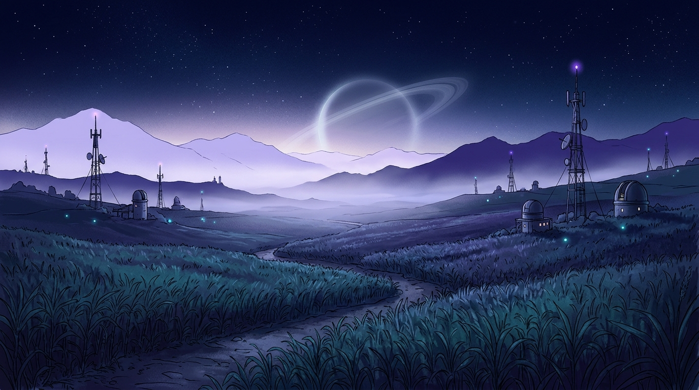

---

### S2: Decision Monitoring Dashboard (`/dashboard`)
*Dominant KPI card (125 total decisions), multi-attribute filter bar (Soil, Status, Action, Override), decision table with AI-vs-Final mini-pairs, and real-time review queue.*
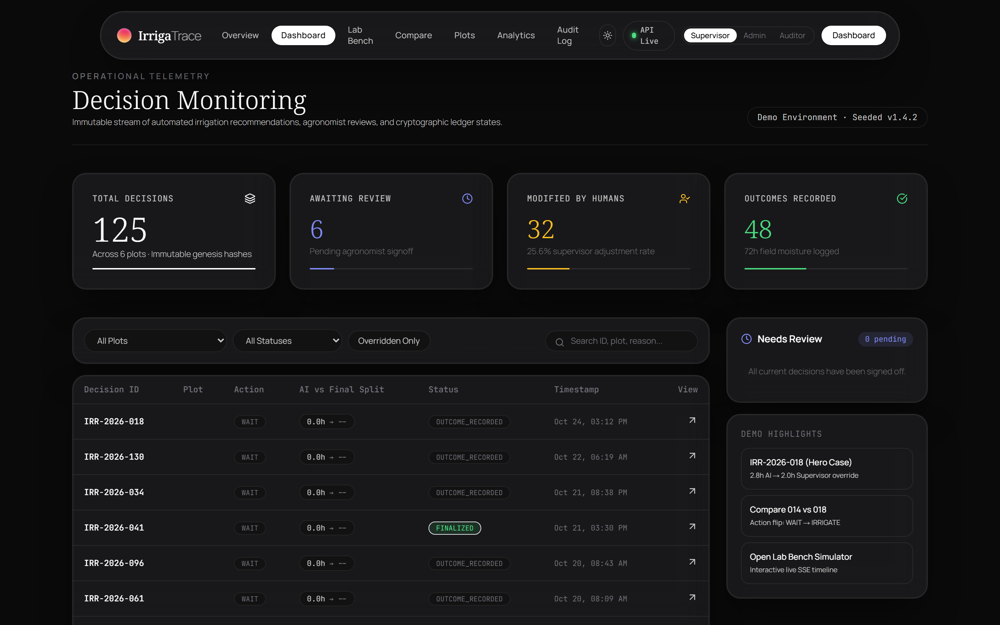

---

### S3: Interactive Decision Case File (`/decisions/[id]`)
*4-tab case file (Overview, Replay, Audit, Outcome), signature AI vs Human split-number hero, deterministic factors card, verified LLM vernacular briefing with Hindi/Kannada translation, and live cryptographic seal.*
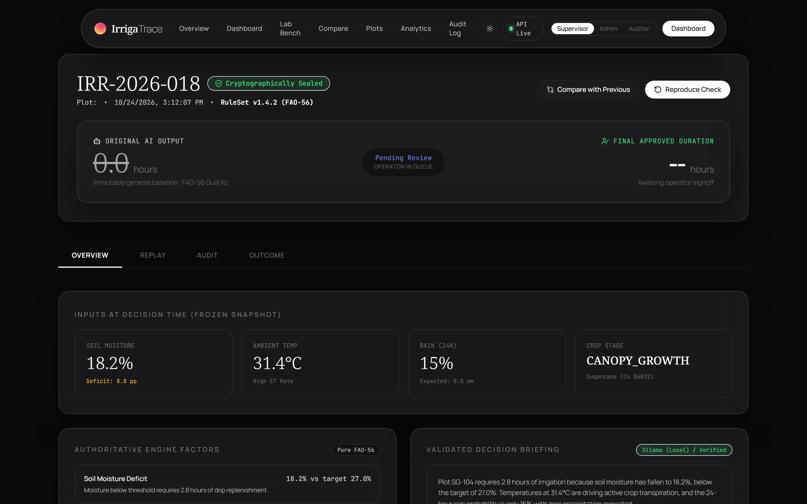

---

### S4: Decision Diff & Single-Variable Flip Analysis (`/compare`)
*Side-by-side comparison between automated recommendations and supervisor adjustments, lavender diff glow on delta parameters, and single-variable flip sensitivity card.*
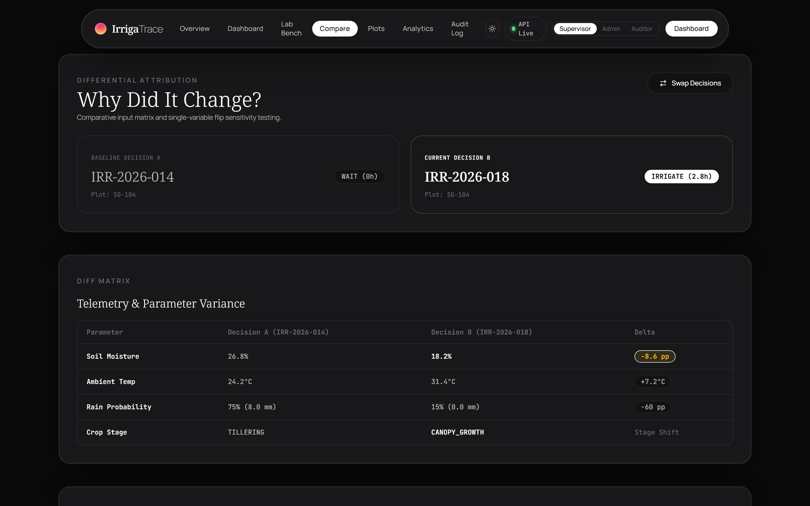

---

### S5: Lab Bench Climate Simulator (`/lab`)
*Interactive environmental sliders (soil moisture, temperature, solar radiation, rain forecast), scenario presets (Drought Stress, Monsoon Approaching), live stateless engine preview, and real decision generation with Server-Sent Events (SSE).*
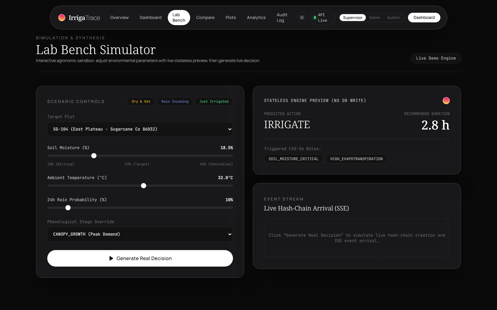

---

### S6: Plots & Microclimate Telemetry (`/plots`)
*Microclimate moisture tracking, soil classifications (Clay Loam, Black Cotton, Sandy Loam), crop stages, and zone telemetry across sugarcane plots SG-104 to SG-125.*
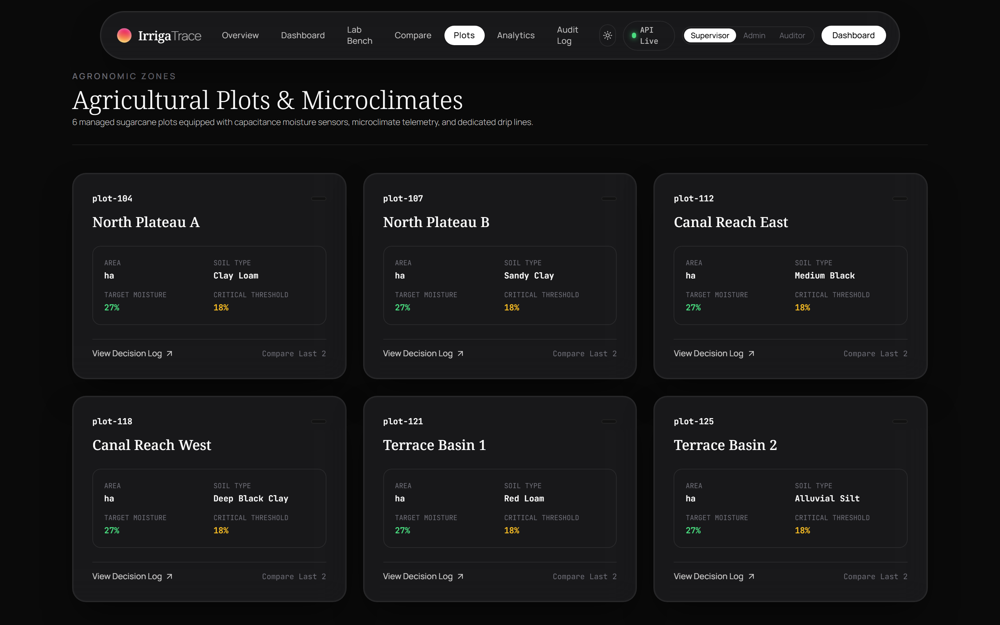

---

### S7: Operational Analytics (`/analytics`)
*Override rate trends, supervisor reason codes breakdown (Canal Rotation, Shading, Rain Clearing), and 72-hour observational post-irrigation field telemetry.*
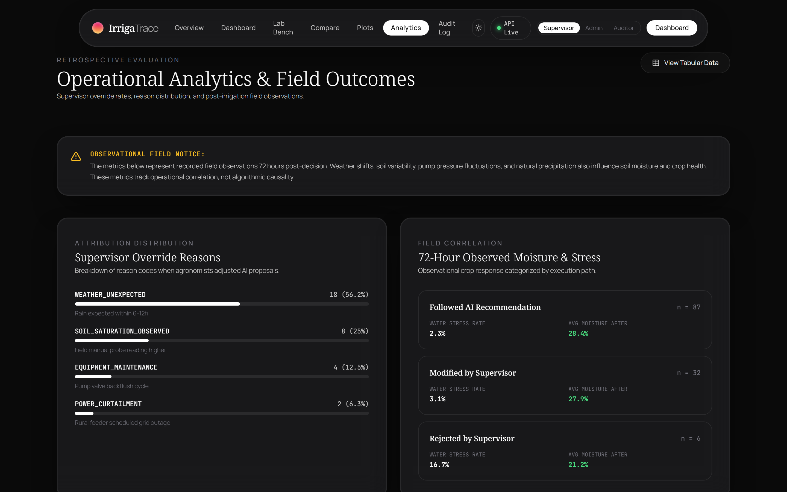

---

### S8: Cryptographic Audit Ledger (`/audit`)
*Batch SHA-256 chain verification, tamper-detection proofs, and immutable event block logs.*
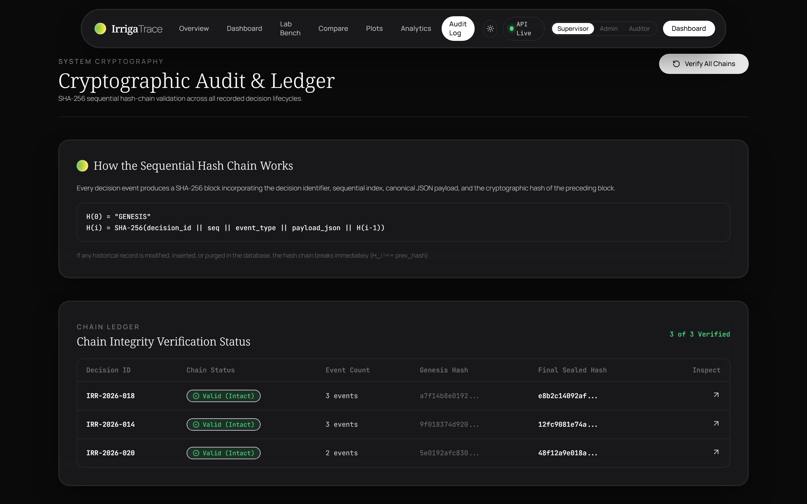

---

## 5. Behavioral & Structural Modeling Diagrams

| Use Case Diagram | Sequence Diagram (Decision Genesis) |
| :---: | :---: |
| 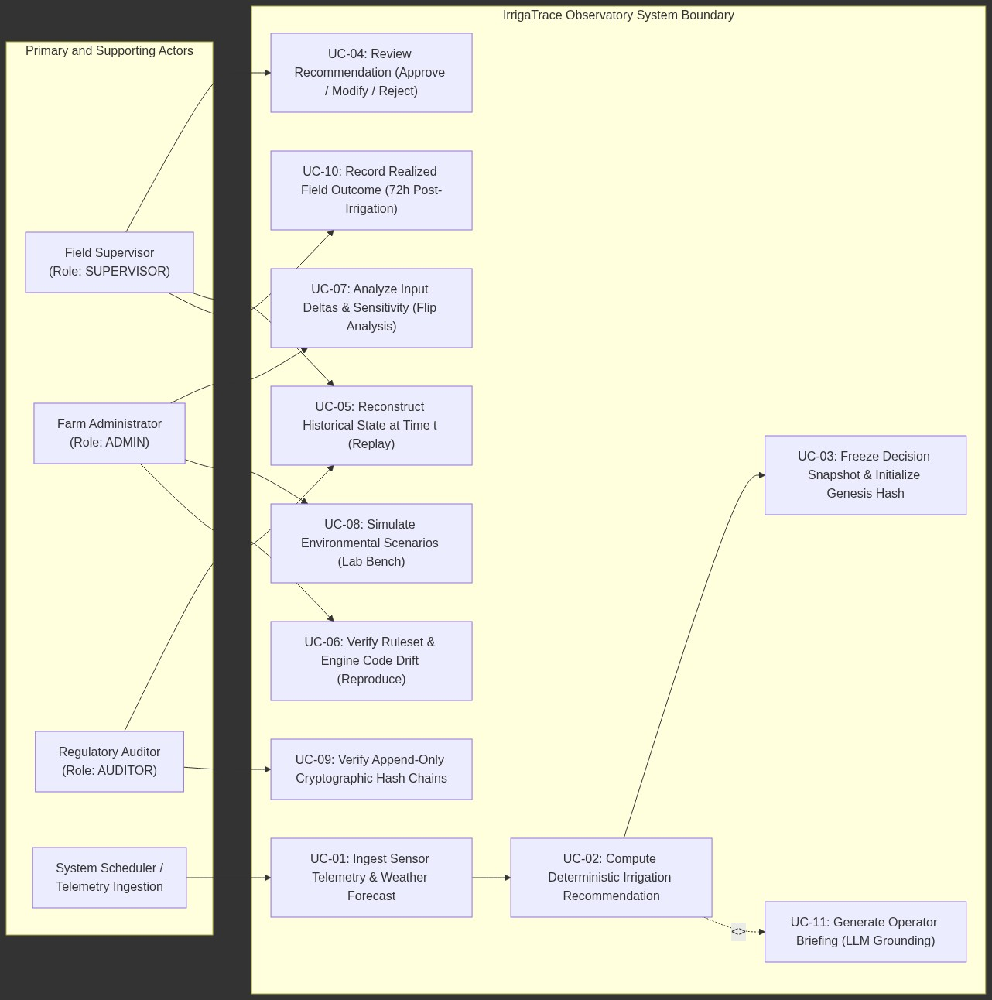 | 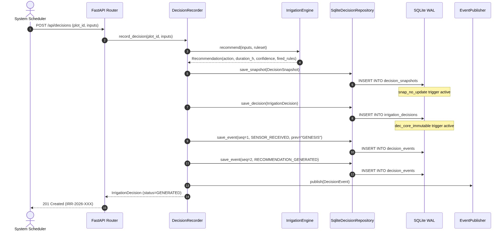 |

| Class Diagram (Clean Architecture) | Entity-Relationship Diagram (ERD) |
| :---: | :---: |
| 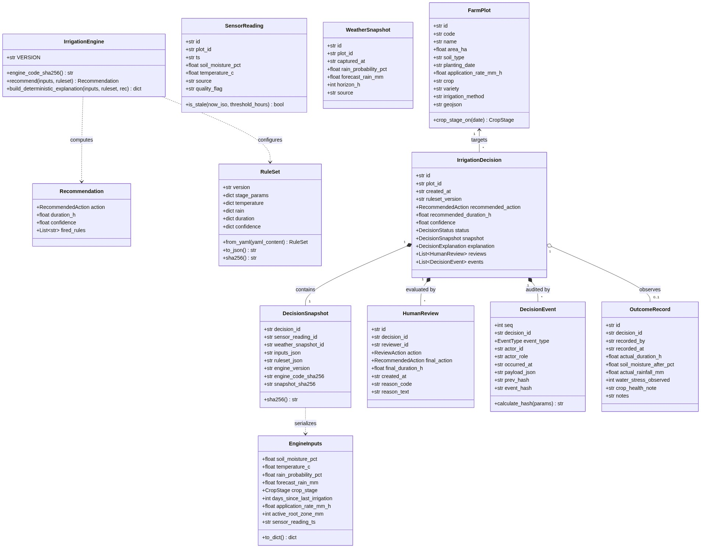 | 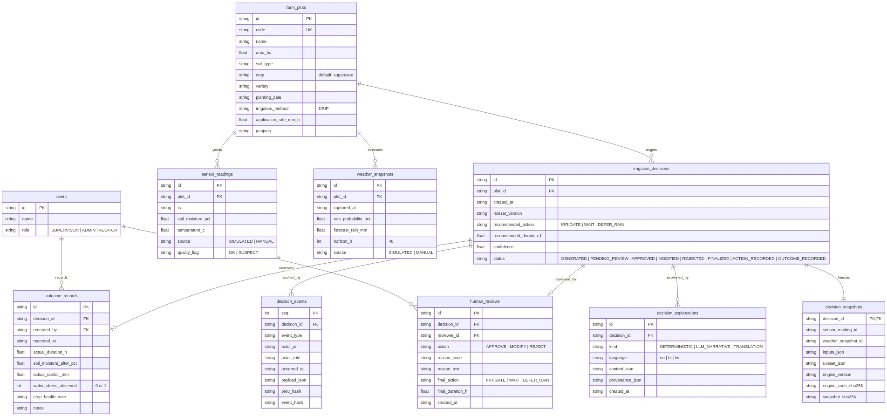 |

---

## 6. OOSE Lab Deliverables (in `docs/oose/`)

Full semester academic lab deliverables, documentation, and IEEE-standard specifications:

* [EXP1: Problem Statement & Agile Process Model](docs/oose/EXP1_PROBLEM_AND_PROCESS.md)
* [EXP2: Software Project Management Plan (SPMP)](docs/oose/EXP2_SPMP.md) *(WBS, Mermaid Gantt, COCOMO & FP estimation, Risk register)*
* [EXP3: IEEE 830 Software Requirements Specification (SRS)](docs/oose/EXP3_SRS.md) *(FR/NFR tables, Traceability matrix)*
* [EXP4: Project Management Tools (JIRA & Trello Setup)](docs/oose/EXP4_PROJECT_MANAGEMENT_TOOLS.md) *(CSV import format, sprint plan)*
* [EXP5: Behavioral UML Modeling](docs/oose/EXP5_BEHAVIORAL_UML.md) *(Use Case, Sequence, Activity, State Machine)*
* [EXP6: Structural UML Modeling](docs/oose/EXP6_STRUCTURAL_UML.md) *(AST-verified Class Diagram, Object Diagram for IRR-2026-018, Component, Deployment)*
* [EXP7: IEEE 1016 System Design Document (SDD)](docs/oose/EXP7_SDD.md) *(Clean Architecture, ERD, 7 Design Patterns)*
* [EXP8: IEEE 829 Software Test Documentation (STD)](docs/oose/EXP8_STD.md) *(24 automated tests passing)*
* [EXP9: Reverse Engineering Methodology & Pipeline](docs/oose/EXP9_REVERSE_ENGINEERING.md)
* [Comprehensive 25-Question Viva Voce Defense Guide](docs/oose/VIVA.md)

---

## 7. Technology Stack

* **Frontend:** Next.js 14 (App Router), TypeScript, Tailwind CSS, Lucide / Phosphor Icons, KaTeX for LaTeX equations
* **Backend:** FastAPI (Python 3.12+), Pydantic v2, SQLite with Write-Ahead Logging (WAL) and native SQL triggers
* **AI & Grounding:** Ollama (`qwen2.5:3b`), FAO-56 Penman-Monteith Deterministic Engine, AST-based `NumberConsistencyValidator`
* **Vector Search:** Qdrant Cloud (with graceful deterministic SQL nearest-neighbor fallback)
* **Testing:** Pytest (Unit, Integration, Invariant Tests), Playwright for UI testing
