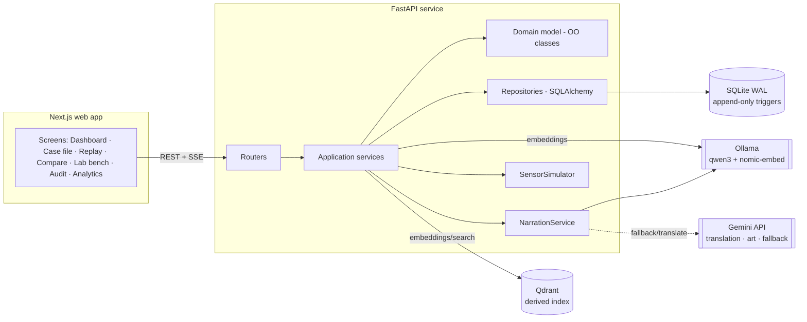
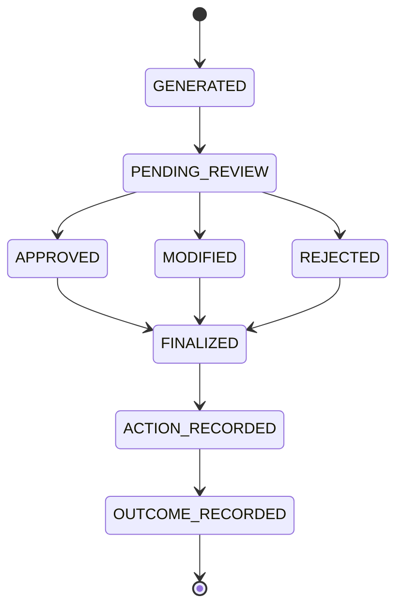

# 02 — Architecture

## System view


## Layers (strict, one-way dependencies)
1. `domain/` — pure Python, no I/O, no framework imports. The OO classes below. Fully unit-testable.
2. `services/` — use-case orchestration (`DecisionRecorder`, `ReviewService`, `DecisionReplayService`, `ComparisonService`, `OutcomeService`, `IntegrityService`, `NarrationService`, `SimilaritySearchService`).
3. `infra/` — SQLAlchemy repositories, Qdrant client, Ollama client, Gemini client, clock, id generator.
4. `api/` — FastAPI routers, Pydantic schemas, auth dependency, SSE.

Dependency rule: `api → services → domain`; `services → infra` via interfaces (Protocols) defined in `domain/ports.py`. Domain never imports infra.

## Domain classes (names are graded — do not rename)
| Class | Responsibility | Key attributes / methods |
|---|---|---|
| `FarmPlot` | Plot & crop information | `id, code, area_ha, soil_type, planting_date, application_rate_mm_h`, `crop_stage_on(date)` |
| `SensorReading` | Time-stamped measurements | `ts, soil_moisture_pct, temperature_c, source, quality_flag`, `is_stale(now)` |
| `WeatherSnapshot` | Forecast preserved at decision time | `captured_at, rain_probability_pct, forecast_rain_mm, horizon_h, source` |
| `IrrigationEngine` | Generates the recommendation | `recommend(inputs: EngineInputs, ruleset: RuleSet) -> Recommendation` (pure) |
| `RuleSet` | Versioned thresholds & rules | `version, stage_params, rain_rules, to_json()`, `sha256()` |
| `Recommendation` | Engine output value object | `action, duration_h, confidence, fired_rules[]` |
| `IrrigationDecision` | One original recommendation (aggregate root) | `id, plot_id, status, recommendation, snapshot, explanation, events[]` |
| `DecisionSnapshot` | Immutable inputs + configuration | `inputs, ruleset_json, engine_version, engine_code_sha256`, `sha256()` |
| `DecisionExplanation` | Explanation + supporting evidence | `factors[], fired_rules[], kind, language, provenance` |
| `HumanReview` | Approval / modification / rejection | `reviewer, action, reason_code, reason_text, final_action, final_duration_h` |
| `DecisionEvent` | One lifecycle event, hash-chained | `seq, type, actor, occurred_at, payload, prev_hash, event_hash` |
| `DecisionReplayService` | Reconstructs historical timeline & state-at-time | `timeline(id)`, `state_at(id, t)`, `reproduce(id)` |
| `DecisionComparison` | Diff of two decisions | `input_deltas, output_deltas, rule_deltas, flips[]` |
| `OutcomeRecord` | Subsequent observations | `actual_duration_h, soil_moisture_after_pct, actual_rainfall_mm, water_stress_observed, note` |

Design patterns to apply (and name in the SDD): **Strategy** (`NarrationStrategy`: Template / Ollama / Gemini), **Repository** (persistence), **State** (decision lifecycle), **Factory** (`DecisionFactory.from_inputs`), **Observer** (event publisher → SSE + Qdrant indexer), **Value Object** (`Recommendation`, `EngineInputs`), **Facade** (`DecisionRecorder`).

## Decision lifecycle (State pattern)

Illegal transitions raise `IllegalTransition` (HTTP 409). `status` on the decision row is a **projection** of the events; `IntegrityService` verifies they agree.

## Repo layout
```
irrigatrace/
├─ AGENTS.md  Makefile  README.md  .env.example  docker-compose.yml(optional)
├─ api/
│  ├─ pyproject.toml            (uv)
│  ├─ irrigatrace/
│  │  ├─ domain/                (classes above, ports.py)
│  │  ├─ services/
│  │  ├─ infra/{db,qdrant,ollama,gemini}/
│  │  ├─ api/{routers,schemas,deps.py,sse.py}
│  │  ├─ rules/rules-v1.4.2.yaml
│  │  └─ main.py
│  ├─ sql/schema.sql  sql/triggers.sql
│  └─ tests/{unit,integration,property}
├─ web/                         (Next.js, pnpm)
│  ├─ app/(marketing)/page.tsx  app/dashboard  app/decisions/[id]  app/compare  app/lab  app/audit  app/analytics  app/plots
│  ├─ components/{ui,decision,timeline,compare,layout}
│  ├─ styles/tokens.css  lib/api.ts  lib/types.ts (generated from OpenAPI)
│  └─ public/art/             (generated illustrations)
├─ design/{reference,stitch-exports,approved}
├─ docs/                        (this pack + generated OOSE docs in docs/oose/)
├─ scripts/                     (pull_models, check_models, seed, reindex_qdrant)
└─ .agent/{rules,skills,workflows}
```

## Core sequences
**Generate**: `Lab bench → POST /decisions` → `DecisionFactory` builds inputs from latest `SensorReading` + `WeatherSnapshot` → `IrrigationEngine.recommend` → `DecisionRecorder` writes decision + snapshot + deterministic explanation + events (SENSOR_RECEIVED, WEATHER_CAPTURED, RECOMMENDATION_GENERATED, EXPLANATION_ATTACHED) in **one transaction** → publishes to SSE → async: `NarrationService` attaches LLM narrative (event NARRATIVE_ATTACHED) → async: indexer upserts into Qdrant.

**Review**: `POST /decisions/{id}/review` → permission check → state check → `HumanReview` insert + events (REVIEW_OPENED if first open, REVIEW_<ACTION>, DECISION_FINALIZED) → original recommendation untouched.

**Replay**: `GET /decisions/{id}/replay` → events ordered by seq → `state_at` folds events into view-model (what was known/decided at each instant).

**Compare**: `GET /compare?a=&b=` → input/output/rule deltas → flip analysis = for each differing input, re-run engine on A's inputs with that single input taken from B (and vice versa) and report whether the action flips.
