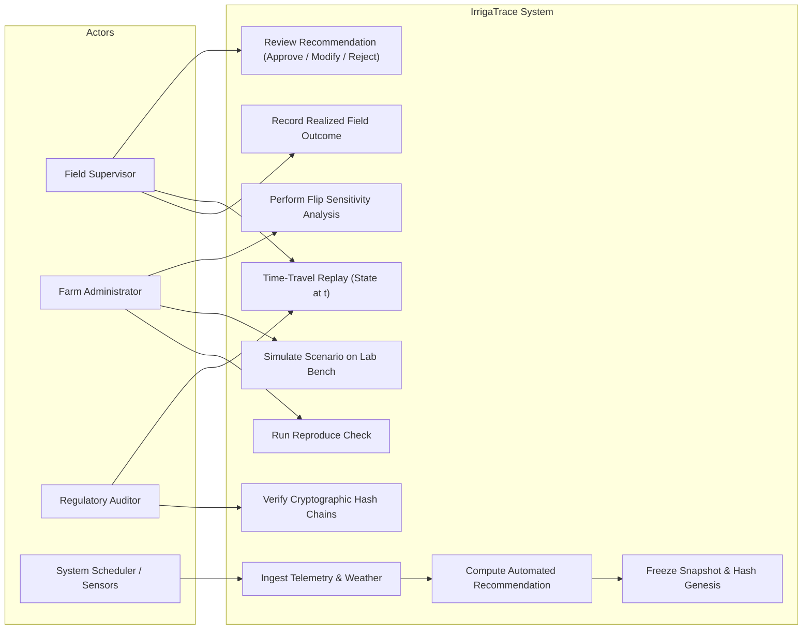
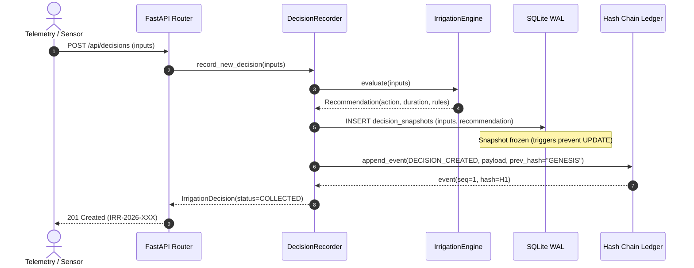
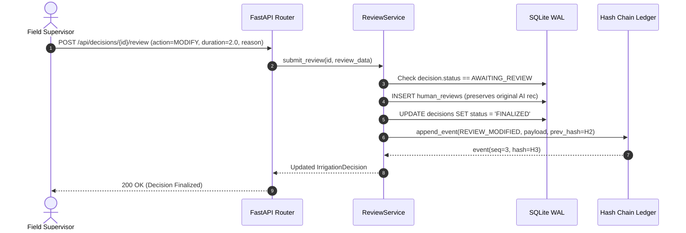
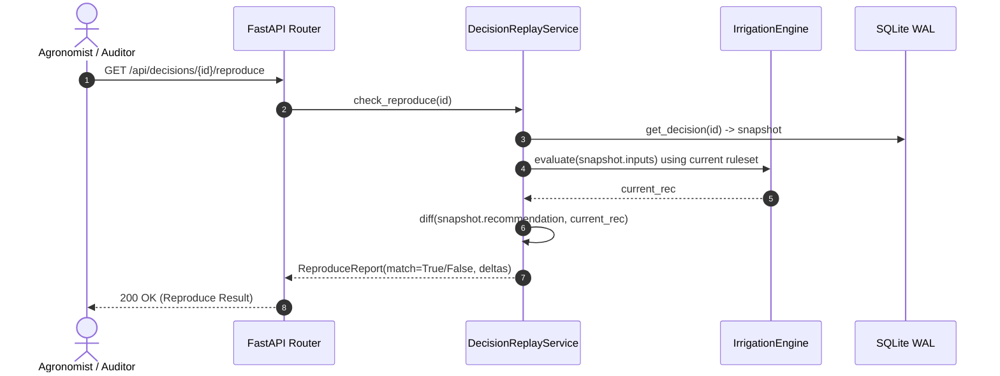
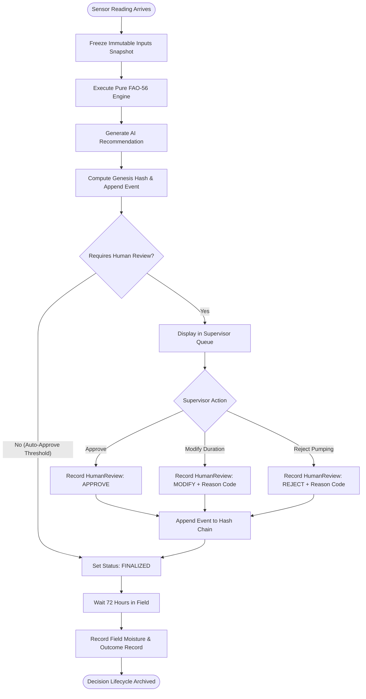
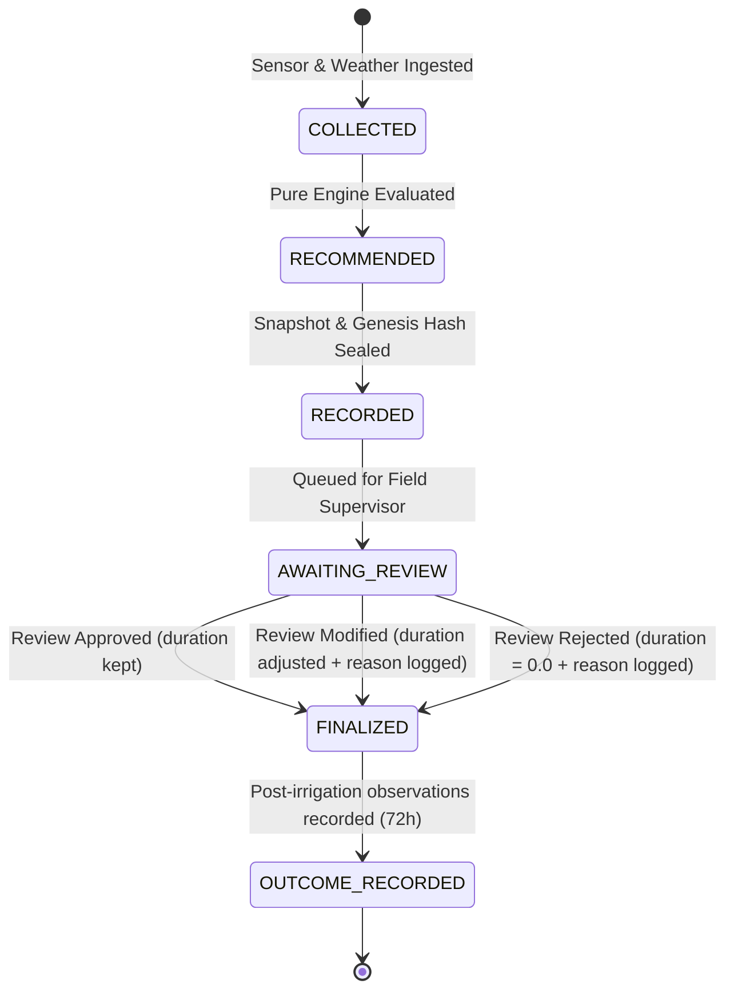

# Experiment 5: Behavioral UML Modeling

**Course:** Object-Oriented Software Engineering (OOSE Lab)  
**Project Code:** KJS-AGR-01  
**Project Title:** IrrigaTrace: Audit, Replay, and Traceability Framework for AI Irrigation Decisions  
**Date:** 2026-10-23  
**Course Outcome:** CO3

---

## 1. Use Case Diagram (3 Actors)

---

## 2. Sequence Diagrams

### 2.1 Sequence 1: Automated Recommendation & Hash Genesis

### 2.2 Sequence 2: Human Review Workflow (Supervisor Override)

### 2.3 Sequence 3: Replay & Reproduce Check

---

## 3. Activity Diagram (Decision Governance Lifecycle)

---

## 4. State Machine Diagram (IrrigationDecision Lifecycle)

