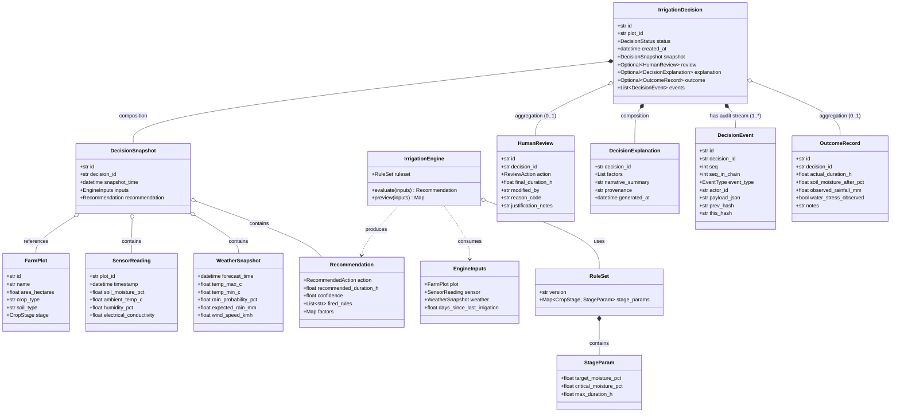
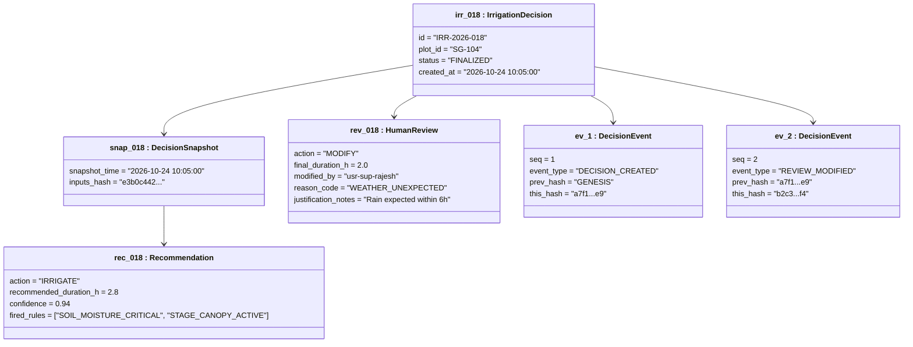
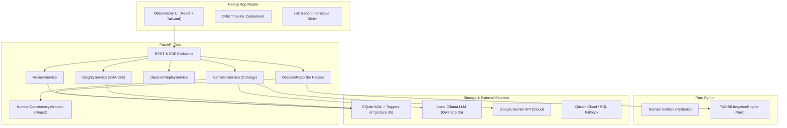

# Experiment 6: Structural UML Modeling

**Course:** Object-Oriented Software Engineering (OOSE Lab)  
**Project Code:** KJS-AGR-01  
**Project Title:** IrrigaTrace: Audit, Replay, and Traceability Framework for AI Irrigation Decisions  
**Date:** 2026-10-23  
**Course Outcome:** CO3

---

## 1. Domain Class Diagram (14 Core Entities)
*Generated directly from active codebase AST (`api/irrigatrace/domain/models.py` & `engine.py`).*



---

## 2. Object Diagram: Instance IRR-2026-018 (Hero Case)



---

## 3. Component Diagram



---

## 4. Deployment Diagram

```mermaid
deploymentDiagram
    node "Client Device (Browser)" {
        artifact "Next.js Web Client (Port 3000)" as WebClient
    }

    node "Host Machine (Windows / Linux)" {
        node "Python Runtime (Port 8000)" {
            artifact "FastAPI Application Server" as APIServer
            artifact "IrrigaTrace Domain & Services" as Services
        }

        node "Database Storage" {
            database "irrigatrace.db (SQLite WAL Mode)" as SQLiteDB
        }

        node "Ollama Inference Daemon (Port 11434)" {
            artifact "Qwen 2.5:3b Local LLM" as OllamaModel
        }
    }

    node "External Cloud Services (TLS)" {
        cloud "Google Gemini AI API" as GeminiCloud
        cloud "Qdrant Cloud Vector Service" as QdrantCloud
    }

    WebClient --> APIServer : HTTP / SSE (Port 8000)
    APIServer --> SQLiteDB : Local File I/O (WAL)
    APIServer --> OllamaModel : HTTP REST (Port 11434)
    APIServer --> GeminiCloud : HTTPS API (gRPC / REST)
    APIServer --> QdrantCloud : HTTPS REST / Graceful Fallback
```
