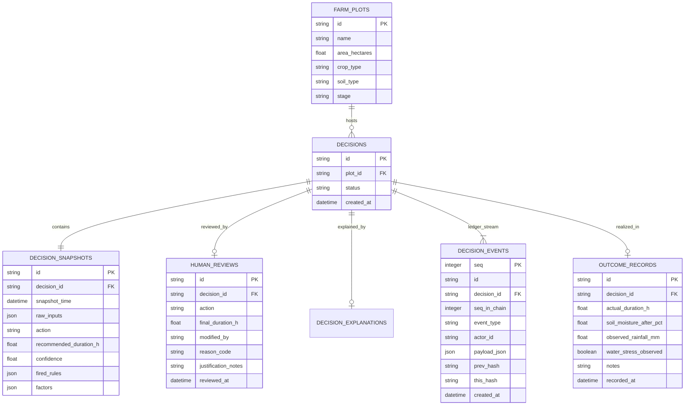

# Experiment 7: System Design Document (SDD)

**Course:** Object-Oriented Software Engineering (OOSE Lab)  
**Standard:** IEEE Std 1016-2009  
**Project Code:** KJS-AGR-01  
**Project Title:** IrrigaTrace: Audit, Replay, and Traceability Framework for AI Irrigation Decisions  
**Date:** 2026-10-23  
**Course Outcome:** CO3

---

## 1. Architectural Overview & Style
IrrigaTrace adheres to a **Clean Hexagonal / Layered Architecture** with distinct decoupling between Domain, Service, Infrastructure, and Presentation layers:
1. **Domain Layer (`api/irrigatrace/domain`):** Pure functional agronomic entities and calculations (`IrrigationEngine`, `models.py`). Zero third-party I/O or network dependencies.
2. **Service Layer (`api/irrigatrace/services`):** Use-case orchestration (`DecisionRecorder`, `ReviewService`, `ReplayService`, `IntegrityService`, `NarrationService`).
3. **Infrastructure Layer (`api/irrigatrace/infra`):** SQLite connection pool with WAL mode, append-only triggers, repository implementations, and external LLM/vector clients.
4. **Presentation Layer (`api/irrigatrace/api` & `web`):** FastAPI REST/SSE endpoints and Next.js frontend observatory interface.

---

## 2. Data Design: Entity-Relationship Diagram (ERD)

---

## 3. Detailed Design Patterns & Class References

| Design Pattern | Purpose in IrrigaTrace | Active Class References in Code |
|---|---|---|
| **Strategy Pattern** | Pluggable LLM narration backends (Ollama local, Gemini cloud, or deterministic fallback). | `NarrationStrategy` (protocol), `OllamaNarrationStrategy`, `GeminiNarrationStrategy`, `TemplateNarrationStrategy` in `api/irrigatrace/services/narration.py`. |
| **Repository Pattern** | Decouples persistence SQL queries from business logic. | `DecisionRepository` and `PlotRepository` in `api/irrigatrace/infra/db/repositories.py`. |
| **Value Object Pattern** | Immutable telemetry data structures without independent identity. | `SensorReading`, `WeatherSnapshot`, `Recommendation` in `api/irrigatrace/domain/models.py`. |
| **State Pattern** | Manages decision lifecycle transitions and enforces valid state progressions. | `DecisionStatus` enum (`COLLECTED` $\to$ `RECOMMENDED` $\to$ `RECORDED` $\to$ `AWAITING_REVIEW` $\to$ `FINALIZED`) in `models.py`. |
| **Observer / SSE Pattern** | Streams real-time timeline events to subscribing web clients. | Server-Sent Events router `/api/decisions/{id}/stream` in `api/irrigatrace/api/decisions.py`. |
| **Facade Pattern** | Simplifies complex orchestration of engine evaluation, snapshot freezing, and hash-chain genesis. | `DecisionRecorder` in `api/irrigatrace/services/decision_recorder.py`. |
| **Factory Pattern** | Instantiates domain models and rule parameters based on crop stages. | `RuleSet.default()` and `StageParam` in `api/irrigatrace/domain/engine.py`. |

---

## 4. Cryptographic Hash Chain Algorithm
For any decision $D$, the hash of event $i$ ($i \ge 1$) is defined as:
$$H_0 = \text{"GENESIS"}$$
$$H_i = \text{SHA-256}\Big(D_{\text{id}} \parallel i \parallel E_{\text{type}} \parallel P_{\text{json}} \parallel H_{i-1}\Big)$$

Where:
- $D_{\text{id}}$: Decision identifier (e.g. `IRR-2026-018`).
- $i$: Monotonic 1-indexed sequence number in the decision's chain (`seq_in_chain`).
- $E_{\text{type}}$: Enumerated event type (`DECISION_CREATED`, `REVIEW_MODIFIED`, etc.).
- $P_{\text{json}}$: Deterministic JSON serialization of the event payload (canonical key ordering).
- $H_{i-1}$: Hex digest of the preceding event's hash (`prev_hash`).
- $H_i$: Hex digest of this event (`this_hash`).
