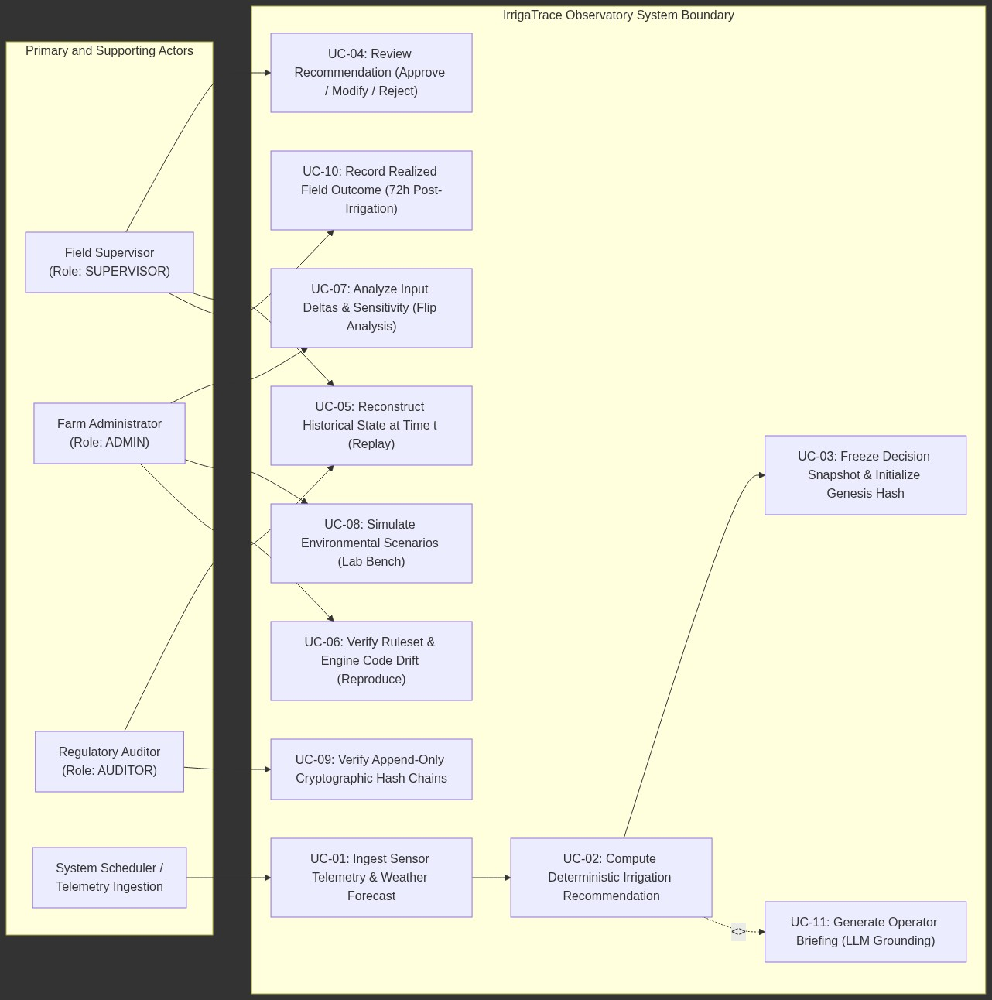
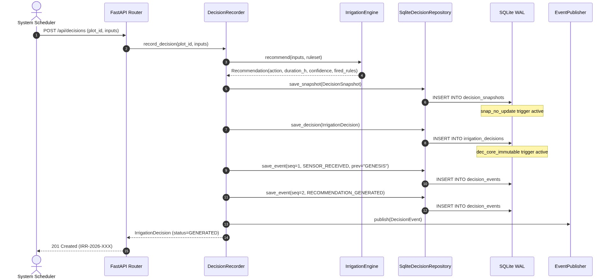
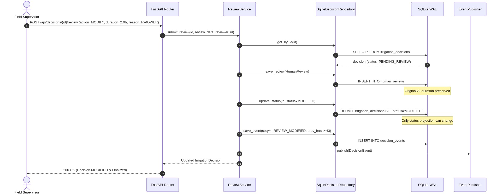
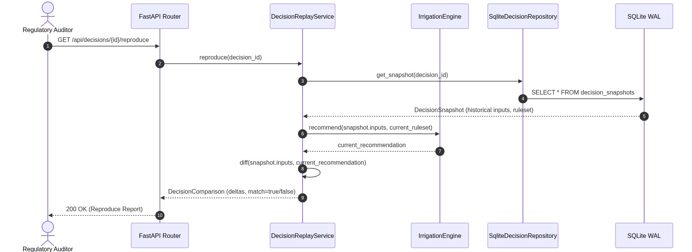
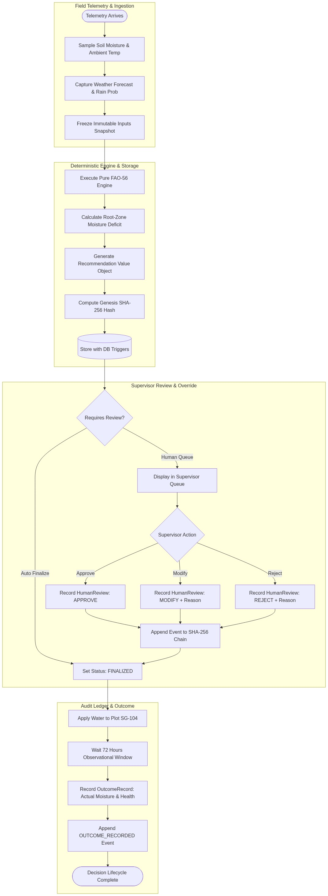
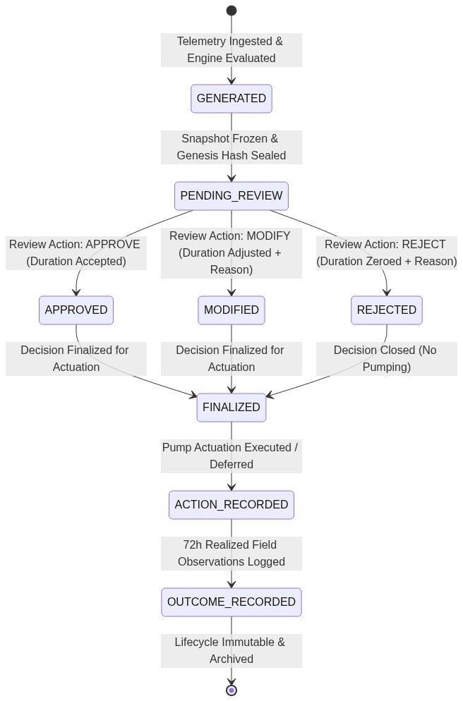
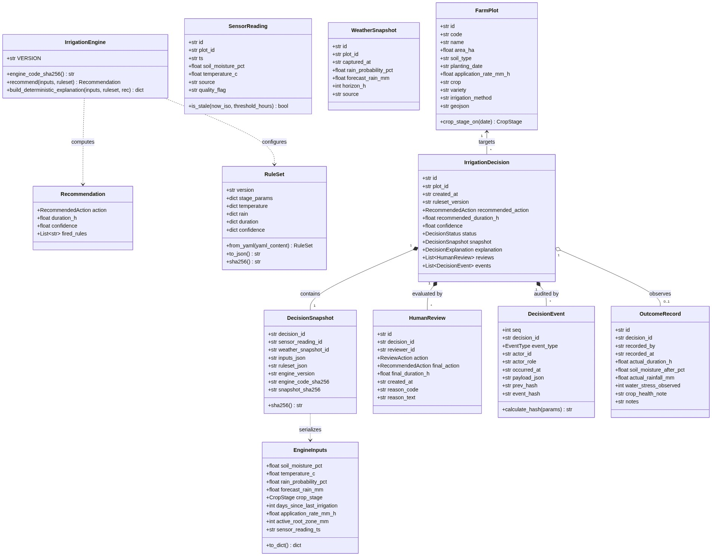
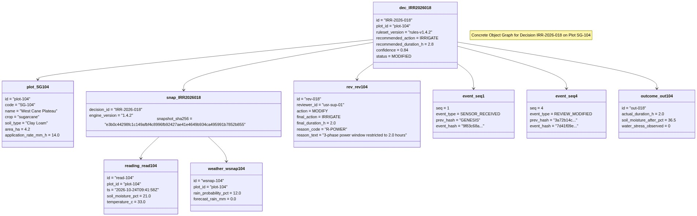

<!--
Source Experiments: Exp 5 (Behavioral UML), Exp 6 (Structural UML).
Figures Included: Fig. 4.1 to Fig. 4.8 (8 Diagrams).
Downstream Notes: IEEE Section 4 formatting. All diagram sources available as .mmd in report/diagrams/. Inline citations [7], [11] used.
-->

# Chapter 4: System Analysis and Object-Oriented Modeling

## 4.1 Introduction to Object-Oriented Modeling
Object-Oriented Analysis and Design (OOAD) models the static structure and dynamic behavioral patterns of software systems through standardized Unified Modeling Language (UML) notations [11]. In IrrigaTrace, UML modeling bridges agronomic domain theory (FAO-56 evapotranspiration) and software architectural constraints (immutability, cryptographic event hashing, and supervisor intervention).

This chapter presents eight comprehensive UML diagrams categorized into **Behavioral Models** (Use Case, Sequence, Activity, State Machine) and **Structural Models** (Class, Object).

---

## 4.2 Behavioral Modeling

### 4.2.1 Use Case Diagram
The Use Case Diagram defines the functional scope of IrrigaTrace across system boundaries and external actors.

  
**Fig. 4.1.** Use Case Diagram of the IrrigaTrace Observatory System.

#### Explanation of Use Case Model
The system boundary encloses eleven discrete use cases interacting with four defined actors:
1. **System Scheduler / Telemetry Ingestion (Boundary Actor):** Periodically executes **UC-01** (*Ingest Sensor Telemetry & Weather Forecast*), which triggers **UC-02** (*Compute Deterministic Irrigation Recommendation*). UC-02 features an `<<include>>` dependency on **UC-11** (*Generate Operator Briefing*) to produce plain-English narrations validated by the regex number consistency engine. Upon successful evaluation, the system invokes **UC-03** (*Freeze Decision Snapshot & Initialize Genesis Hash*).
2. **Field Supervisor (Primary Human Actor):** Interacts directly with **UC-04** (*Review Recommendation*), choosing to approve, modify, or reject automated recommendations while submitting mandatory agronomic justification codes. The supervisor also inspects temporal timelines via **UC-05** (*Reconstruct Historical State at Time t*) and logs post-irrigation field observations via **UC-10** (*Record Realized Field Outcome*).
3. **Farm Administrator (Administrative Actor):** Utilizes **UC-07** (*Analyze Input Deltas & Sensitivity*) to assess why actions flip across plots, evaluates hypothetical environmental conditions in **UC-08** (*Simulate Environmental Scenarios on Lab Bench*), and verifies code integrity via **UC-06** (*Verify Ruleset & Engine Code Drift*).
4. **Regulatory Auditor (Compliance Actor):** Possesses read-only privileges to execute **UC-05** (*Time-Travel Replay*) and **UC-09** (*Verify Append-Only Cryptographic Hash Chains*).

---

### 4.2.2 Interaction Modeling: Sequence Diagrams

#### 1. Automated Recommendation & Genesis Hash Generation
Fig. 4.2 models the synchronous end-to-end flow of generating an automated recommendation and establishing the cryptographic genesis hash.

  
**Fig. 4.2.** Sequence Diagram 1 — Automated Recommendation and Hash Genesis.

*Interaction Walkthrough:*
1. The `System Scheduler` initiates an automated cycle via `POST /api/decisions`.
2. The `FastAPI Router` delegates execution to the `DecisionRecorder` application facade.
3. `DecisionRecorder` invokes the pure functional method `recommend(inputs, ruleset)` on `IrrigationEngine`.
4. `IrrigationEngine` returns an immutable `Recommendation` value object containing recommended duration, confidence score, and fired rules.
5. `DecisionRecorder` constructs a `DecisionSnapshot` containing canonical JSON inputs, ruleset copy, and code SHA-256 hashes, writing it to `SqliteDecisionRepository`.
6. Database-level trigger `snap_no_update` immediately locks the snapshot row against any future SQL `UPDATE` or `DELETE`.
7. `DecisionRecorder` writes the aggregate root `IrrigationDecision` with initial status `GENERATED`.
8. The recorder appends the initial event `SENSOR_RECEIVED` with `prev_hash = "GENESIS"`, computes event hash $H_1$, appends `RECOMMENDATION_GENERATED` ($H_2$), and publishes the event via `EventPublisher` to the SSE stream.

---

#### 2. Human Review Workflow & Supervisor Override
Fig. 4.3 illustrates the execution flow when a Field Supervisor overrides an automated recommendation.

  
**Fig. 4.3.** Sequence Diagram 2 — Human Review Workflow and Supervisor Override.

*Interaction Walkthrough:*
1. The `Field Supervisor` submits an override adjustment via `POST /api/decisions/{id}/review` specifying modified action (`MODIFY`), duration (`2.0h`), and reason code (`R-POWER`).
2. The router passes the request to `ReviewService.submit_review()`.
3. `ReviewService` queries `SqliteDecisionRepository` to verify that current decision status is `PENDING_REVIEW`.
4. `ReviewService` instantiates a first-class `HumanReview` entity and persists it via `save_review()`. Crucially, the original recommendation fields on `irrigation_decisions` are untouched.
5. The service updates the decision projection status to `MODIFIED` via `update_status()`. The database trigger permits updating `status` while rejecting any mutation of the original AI duration.
6. `ReviewService` constructs event `REVIEW_MODIFIED`, links it to the previous hash $H_3$, and persists event sequence 4.

---

#### 3. Time-Travel Replay and Reproduce Check
Fig. 4.4 models the audit verification interaction executed by a Regulatory Auditor.

  
**Fig. 4.4.** Sequence Diagram 3 — Time-Travel Replay and Reproduce Check.

*Interaction Walkthrough:*
1. The `Regulatory Auditor` triggers a code reproducibility audit via `GET /api/decisions/{id}/reproduce`.
2. `DecisionReplayService` retrieves the frozen `DecisionSnapshot` from the repository.
3. The replay service extracts the historical `inputs_json` and evaluates them against the *current* active ruleset using `IrrigationEngine.recommend()`.
4. The service computes a differential comparison between historical recommendation and current recommendation.
5. `DecisionReplayService` packages the output into a `DecisionComparison` object indicating whether ruleset drift has occurred (`match: true/false`).

---

### 4.2.3 Activity Diagram: Decision Governance Lifecycle
Fig. 4.5 captures the end-to-end control and data flow of the governance lifecycle across four functional swimlanes.

  
**Fig. 4.5.** Activity Diagram of the Decision Governance Lifecycle with Swimlanes.

#### Explanation of Process Flow
The activity model partitions execution into four swimlanes:
- **Field Telemetry & Ingestion:** Samples soil moisture and ambient temperature, retrieves meteorological forecasts, and freezes inputs into an immutable snapshot.
- **Deterministic Engine & Storage:** Executes pure FAO-56 logic, computes root-zone moisture deficit, calculates application duration, hashes the snapshot, and commits the records under active SQLite triggers.
- **Supervisor Review & Override:** Evaluates whether confidence or plot conditions mandate review. If flagged, the decision enters the supervisor queue. The supervisor selects one of three paths: `APPROVE`, `MODIFY` (with duration delta and reason code), or `REJECT` (with reason code). The selected action is appended to the SHA-256 chain, transitioning the decision to `FINALIZED`.
- **Audit Ledger & Outcome:** Water is physically applied to the plot. Following a 72-hour observational window, field operators log realized moisture readings and crop health indices into an immutable `OutcomeRecord`, sealing the decision lifecycle.

---

### 4.2.4 State Machine Diagram: Decision Lifecycle State Transitions
Fig. 4.6 formalizes the finite state transitions governing an `IrrigationDecision` entity.

  
**Fig. 4.6.** State Machine Diagram of the `IrrigationDecision` Lifecycle.

#### State Transition Rules
The state machine strictly mirrors the `DecisionStatus` domain enumeration:
- **`[*] --> GENERATED`:** Triggered upon telemetry arrival and pure engine calculation.
- **`GENERATED --> PENDING_REVIEW`:** Triggered when the decision snapshot is frozen and the genesis hash is committed.
- **`PENDING_REVIEW --> APPROVED`:** Triggered when a supervisor accepts the AI recommendation without modifications.
- **`PENDING_REVIEW --> MODIFIED`:** Triggered when a supervisor alters the duration or action and supplies a mandatory reason code.
- **`PENDING_REVIEW --> REJECTED`:** Triggered when a supervisor aborts irrigation and supplies an agronomic justification code.
- **`APPROVED / MODIFIED / REJECTED --> FINALIZED`:** The decision is locked and dispatched for field actuation.
- **`FINALIZED --> ACTION_RECORDED`:** Triggered when physical valve actuation or scheduled pump timing begins.
- **`ACTION_RECORDED --> OUTCOME_RECORDED`:** Triggered when 72-hour observational field outcomes are logged.
- **`OUTCOME_RECORDED --> [*]`:** The decision lifecycle is sealed and permanently immutable.

---

## 4.3 Structural Modeling

### 4.3.1 Domain Class Diagram
Fig. 4.7 illustrates the complete static structural design of the domain model, capturing all 14 core domain classes, value objects, and relationships.

  
**Fig. 4.7.** Domain Class Diagram of the IrrigaTrace Framework.

#### Structural Breakdown and Design Decisions
1. **Separation of Entity vs. Value Object:** Classes possessing distinct conceptual identity and lifecycle tracking (`FarmPlot`, `IrrigationDecision`, `DecisionSnapshot`, `HumanReview`, `OutcomeRecord`) are modeled as entities. Classes representing immutable, interchangeable measurements (`SensorReading`, `WeatherSnapshot`, `Recommendation`, `EngineInputs`, `StageParam`) are modeled as frozen value objects [7].
2. **Aggregate Root Pattern:** `IrrigationDecision` acts as the aggregate root governing a composition of `DecisionSnapshot` (1:1), `HumanReview` (1:N), and `DecisionEvent` (1:N).
3. **Decoupled Engine:** `IrrigationEngine` is a stateless class containing pure class methods (`recommend`, `engine_code_sha256`). It maintains zero instance state and accepts `EngineInputs` and `RuleSet` as explicit arguments, guaranteeing deterministic execution.

---

### 4.3.2 Object Diagram: Concrete Runtime Snapshot
Fig. 4.8 models a concrete object graph of a real decision instance (`IRR-2026-018`) executed on Sugarcane Plot `SG-104`.

  
**Fig. 4.8.** Object Diagram for Decision `IRR-2026-018` on Plot `SG-104`.

#### Runtime Value Verification
- **`plot_SG104`:** Clay Loam soil, 4.2 hectares, application rate $14.0\text{ mm/h}$.
- **`reading_read104`:** Soil moisture $21.0\%$, temperature $33.0^\circ\text{C}$ (triggering a $0.9^\circ\text{C}$ temperature uplift).
- **`dec_IRR2026018`:** Original AI calculated duration $2.8\text{ hours}$ (confidence $0.84$).
- **`rev_rev104`:** Field Supervisor override adjusting final duration to $2.0\text{ hours}$ under reason code `R-POWER` ("3-phase power window restricted to 2.0 hours").
- **`event_seq1` & `event_seq4`:** Sequential SHA-256 event blocks proving cryptographic continuity from `GENESIS` to `REVIEW_MODIFIED`.
- **`outcome_out104`:** Field moisture verified at $36.5\%$ post-irrigation with zero water stress observed.

---

*Summary:* This chapter established the dynamic behavioral workflows and static structural representations of IrrigaTrace through eight standardized UML models. The subsequent chapter details the system architecture, design patterns, and deployment configurations.
