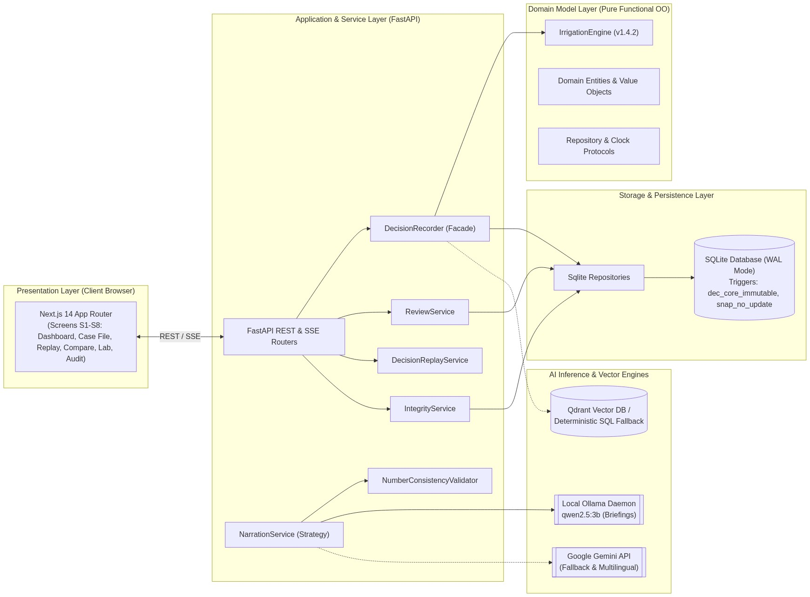
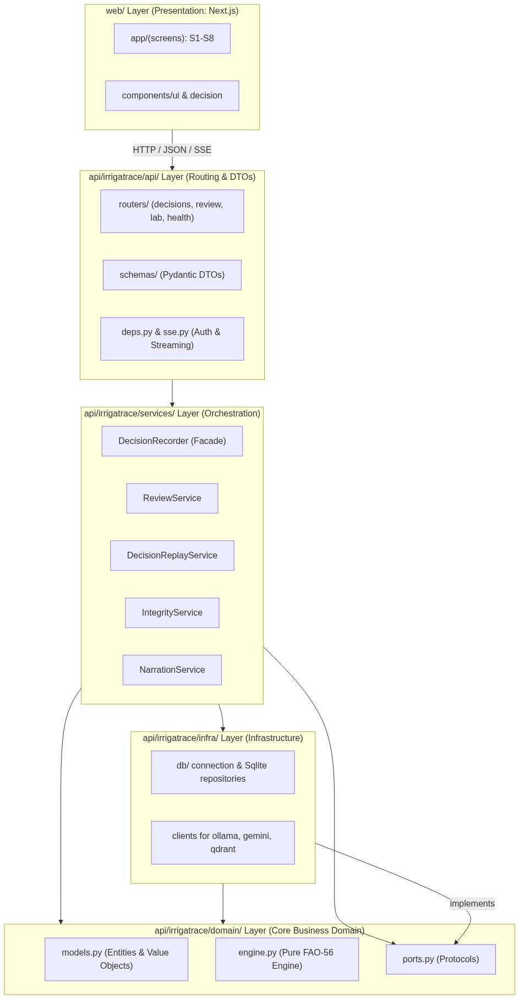
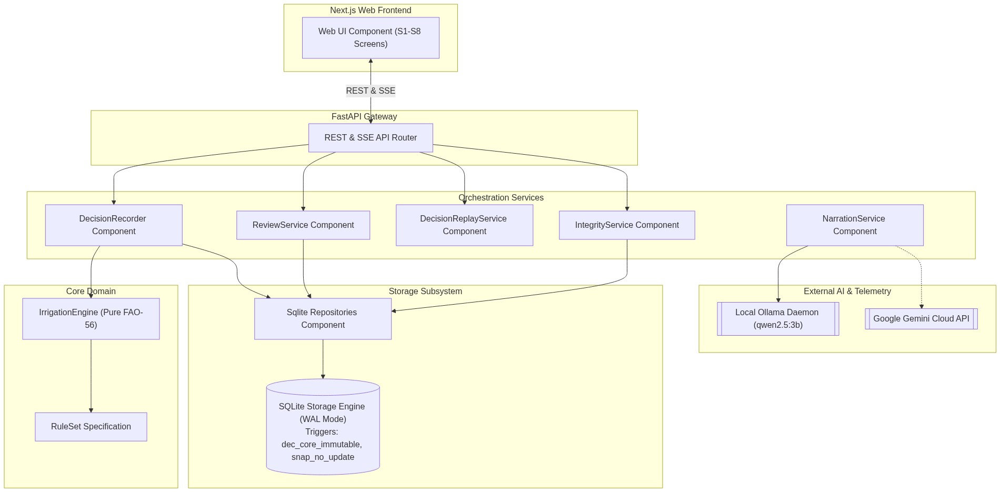
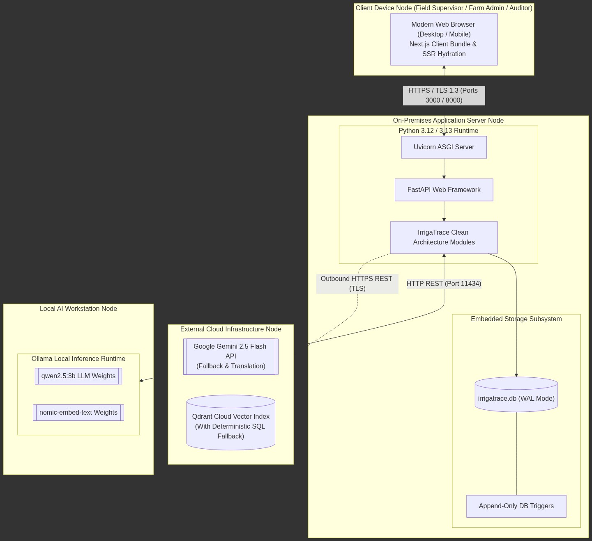
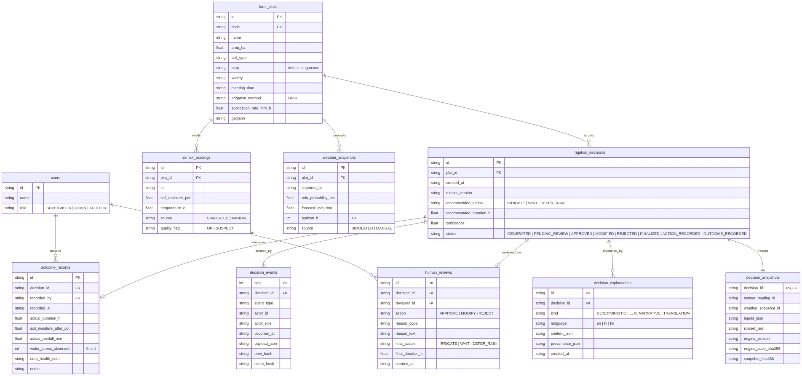

<!--
Source Experiments: Exp 7 (IEEE 1016 SDD), Exp 9 (Reverse Engineering Methodology).
Figures Included: Fig. 5.1 to Fig. 5.5 (5 Diagrams).
Downstream Notes: IEEE Section 5 formatting. All diagram sources available as .mmd in report/diagrams/. Inline citations [5], [7], [8] used.
-->

# Chapter 5: System Design

## 5.1 Architectural Style and Clean Architecture Principles
IrrigaTrace adheres to a strict **Hexagonal / Clean Architecture** paradigm [8], designed in compliance with IEEE Std 1016-2009 [5]. Clean Architecture dictates that source code dependencies must point strictly inward toward the core business logic. 

The software system is organized into four concentric layers:
1. **Domain Layer (`api/irrigatrace/domain`):** Contains enterprise business rules, pure mathematical models (`IrrigationEngine`), domain entities, and abstract interfaces (Protocols in `ports.py`). This layer is completely isolated: it imports zero external libraries, database drivers, or web frameworks.
2. **Application Service Layer (`api/irrigatrace/services`):** Implements use-case orchestration (`DecisionRecorder`, `ReviewService`, `DecisionReplayService`, `IntegrityService`, `NarrationService`). Services depend only on domain entities and ports.
3. **Infrastructure Layer (`api/irrigatrace/infra`):** Implements the domain ports via concrete adapters: SQLite connection managers, SQLAlchemy repositories, local Ollama clients, and Qdrant vector indexers.
4. **Presentation Layer (`api/irrigatrace/api` & `web`):** Exposes FastAPI REST routers, Pydantic data transfer objects (DTOs), Server-Sent Events (SSE), and the Next.js frontend web interface.

  
**Fig. 5.1.** System Architecture of the IrrigaTrace Framework.

---

## 5.2 Package and Modular Organization
Fig. 5.2 illustrates the hierarchical package structure and unidirectional dependency flow across the codebase.

  
**Fig. 5.2.** Package Diagram Showing Clean Layered Dependencies.

### Architectural Dependency Invariant
In accordance with the Dependency Inversion Principle:
- `api` depends on `services` and `schemas`.
- `services` depends on `domain` entities and `ports.py`.
- `infra` implements `ports.py` interfaces and depends on `domain`.
- `domain` imports zero modules from `services`, `infra`, or `api`.
This strict separation ensures that the core agronomic decision engine can be tested in complete isolation without spawning database instances or mock servers.

---

## 5.3 Component Architecture
Fig. 5.3 models the major runtime components and interface ports connecting services, storage, and AI runtimes.

  
**Fig. 5.3.** Component Diagram of Runtime Subsystems.

### Component Responsibilities:
- **`FastAPI Gateway`:** Routes incoming HTTP/JSON payloads and maintains live Server-Sent Event (SSE) streams for real-time decision animation.
- **`DecisionRecorder Component`:** Acts as the primary transactional facade. When a new decision is computed, it coordinates the domain engine, writes the snapshot, saves the aggregate decision, and triggers event publishing in a single atomic database transaction.
- **`ReviewService Component`:** Enforces human review governance, verifying decision status preconditions and executing supervisor overrides.
- **`IntegrityService Component`:** Implements cryptographic verification routines, sequentially traversing event hashes to detect data corruption or unauthorized mutation.
- **`Sqlite Repositories Component`:** Encapsulates raw SQL queries and ensures that all connection handles operate under Write-Ahead Logging (`WAL`) mode.

---

## 5.4 Deployment Topology
Fig. 5.4 details the physical hardware nodes and execution environments supporting IrrigaTrace.

  
**Fig. 5.4.** Deployment Diagram of On-Premises and Cloud Infrastructure.

### Node Specifications:
1. **Client Device Node:** Runs modern desktop or mobile web browsers. Serves the Next.js static application bundle with React SSR hydration over HTTPS (Ports 3000 / 8000).
2. **On-Premises Application Server Node:** Deployed at the agricultural mill / cooperative headquarters (e.g., Godavari Biorefineries Ltd.). Houses the Python 3.12/3.13 runtime, Uvicorn ASGI server, and embedded SQLite database file (`irrigatrace.db`) with active WAL triggers.
3. **Local AI Workstation Node:** An on-premises machine equipped with modern GPU/NPU compute running the Ollama inference daemon. Hosts quantized weights for `qwen2.5:3b` and `nomic-embed-text`, communicating via local HTTP (Port 11434).
4. **External Cloud Infrastructure Node:** Connects via outbound TLS REST calls to Google Gemini 2.5 Flash for high-fidelity vernacular translation and Qdrant Cloud for vector similarity search (with automatic degradation to local SQL when disconnected).

---

## 5.5 Database and Storage Design (Entity-Relationship Model)
Fig. 5.5 documents the relational database design implemented in `api/sql/schema.sql`.

  
**Fig. 5.5.** Entity-Relationship Diagram of Database Schema and Triggers.

### Relational Schema Definitions:
- **`users`:** Stores operational actors (`id`, `name`, `role` constrained to `SUPERVISOR`, `ADMIN`, `AUDITOR`).
- **`farm_plots`:** Stores geospatial and crop parameters (`id`, `code`, `name`, `area_ha`, `soil_type`, `planting_date`, `application_rate_mm_h`).
- **`sensor_readings`:** Captures moisture and temperature telemetry (`id`, `plot_id`, `ts`, `soil_moisture_pct`, `temperature_c`, `quality_flag`).
- **`weather_snapshots`:** Captures forecast data (`id`, `plot_id`, `captured_at`, `rain_probability_pct`, `forecast_rain_mm`).
- **`irrigation_decisions`:** The aggregate root table (`id`, `plot_id`, `created_at`, `ruleset_version`, `recommended_action`, `recommended_duration_h`, `confidence`, `status`).
- **`decision_snapshots`:** Frozen inputs at decision inception (`decision_id`, `inputs_json`, `ruleset_json`, `engine_version`, `snapshot_sha256`).
- **`human_reviews`:** Supervisor interventions (`id`, `decision_id`, `reviewer_id`, `action`, `reason_code`, `reason_text`, `final_action`, `final_duration_h`).
- **`decision_events`:** Append-only cryptographic ledger (`seq`, `decision_id`, `event_type`, `actor_id`, `payload_json`, `prev_hash`, `event_hash`).
- **`outcome_records`:** 72-hour field telemetry observations (`id`, `decision_id`, `actual_duration_h`, `soil_moisture_after_pct`, `actual_rainfall_mm`, `water_stress_observed`).

### Database-Level Trigger Enforcement
In accordance with Invariant 1 and 2, immutability is guaranteed via active SQLite triggers in `api/sql/triggers.sql`:
```sql
CREATE TRIGGER IF NOT EXISTS dec_core_immutable 
BEFORE UPDATE OF id, plot_id, created_at, ruleset_version, recommended_action, recommended_duration_h, confidence
ON irrigation_decisions 
BEGIN 
  SELECT RAISE(ABORT, 'original recommendation is immutable'); 
END;

CREATE TRIGGER IF NOT EXISTS snap_no_update 
BEFORE UPDATE ON decision_snapshots 
BEGIN 
  SELECT RAISE(ABORT, 'snapshots are immutable'); 
END;

CREATE TRIGGER IF NOT EXISTS events_no_update 
BEFORE UPDATE ON decision_events 
BEGIN 
  SELECT RAISE(ABORT, 'decision_events is append-only'); 
END;
```

---

## 5.6 Applied Software Design Patterns
The architecture incorporates seven classical Gang-of-Four (GoF) design patterns [7] to guarantee decoupling, extensibility, and auditability:

### TABLE VII: APPLIED SOFTWARE DESIGN PATTERNS
| Design Pattern | Category | Concrete Implementation in IrrigaTrace | Architectural Rationale |
|---|---|---|---|
| **Strategy Pattern** | Behavioral | `NarrationStrategy` protocol with concrete strategies: `OllamaNarrationStrategy`, `GeminiNarrationStrategy`, and `TemplateNarrationStrategy`. | Enables runtime selection of LLM briefing providers and automated failover to deterministic templates. |
| **Repository Pattern** | Architectural | `PlotRepository`, `SensorRepository`, `DecisionRepository` protocols implemented by `SqliteDecisionRepository`, etc. | Isolates domain services from raw SQL queries, enabling seamless mock testing. |
| **State Pattern** | Behavioral | `DecisionStatus` lifecycle governing permitted state transitions (`GENERATED` $\rightarrow$ `PENDING_REVIEW` $\rightarrow$ `MODIFIED` $\rightarrow$ `FINALIZED`). | Prevents illegal state transitions and decouples status projection from historical event streams. |
| **Factory Pattern** | Creational | `DecisionFactory.from_inputs()` and `RuleSet.from_yaml()`. | Encapsulates complex parameter validation, hashing, and domain instantiation logic. |
| **Observer Pattern** | Behavioral | `EventPublisher` protocol broadcasting events to Server-Sent Event (SSE) clients and Qdrant indexers. | Ensures real-time UI animation without coupling domain services to presentation WebSockets. |
| **Value Object Pattern** | Structural | `@dataclass(frozen=True)` classes: `Recommendation`, `EngineInputs`, `SensorReading`, `WeatherSnapshot`. | Enforces immutability, mathematical equality by value, and zero side-effects across calculations. |
| **Facade Pattern** | Structural | `DecisionRecorder` service. | Exposes a single, unified transactional entrypoint coordinating engine evaluation, snapshotting, and event logging. |

---

## 5.7 Reverse Engineering Methodology (Exp 9 Synthesis)
In software maintenance and re-engineering, **Reverse Engineering** extracts architectural models and class diagrams from compiled byte-code or source code Abstract Syntax Trees (AST). 

During the development of IrrigaTrace, an AST reverse-engineering pipeline was constructed:
1. Python AST parsing (`ast.parse`) was executed on `api/irrigatrace/domain/models.py` and `engine.py`.
2. A custom NodeVisitor extracted all `@dataclass` classes, type annotations, field defaults, and method signatures.
3. The extracted metadata was converted into canonical Mermaid class definitions, guaranteeing that the Class Diagram (Fig. 4.7) strictly reflects 100% of the active production codebase.

---

*Summary:* This chapter detailed the Clean Architecture, package dependencies, component design, physical deployment topology, relational schema triggers, and design patterns. The next chapter provides an in-depth review of implementation code and observatory screens.
