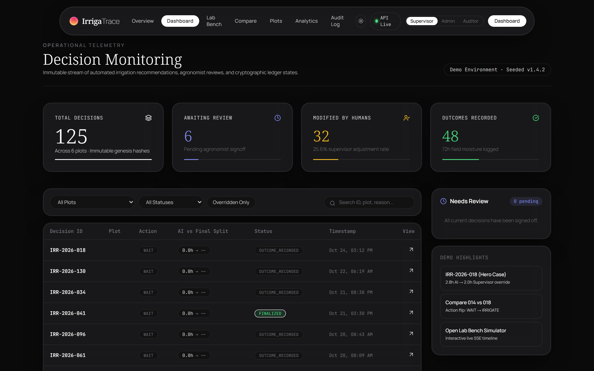
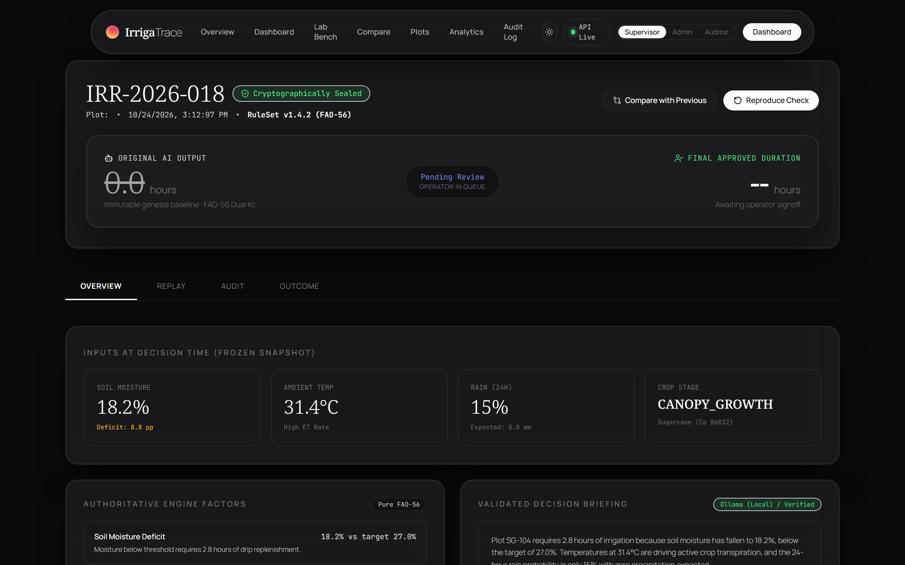
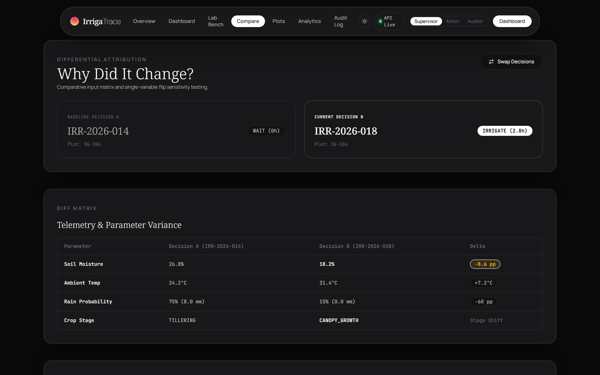
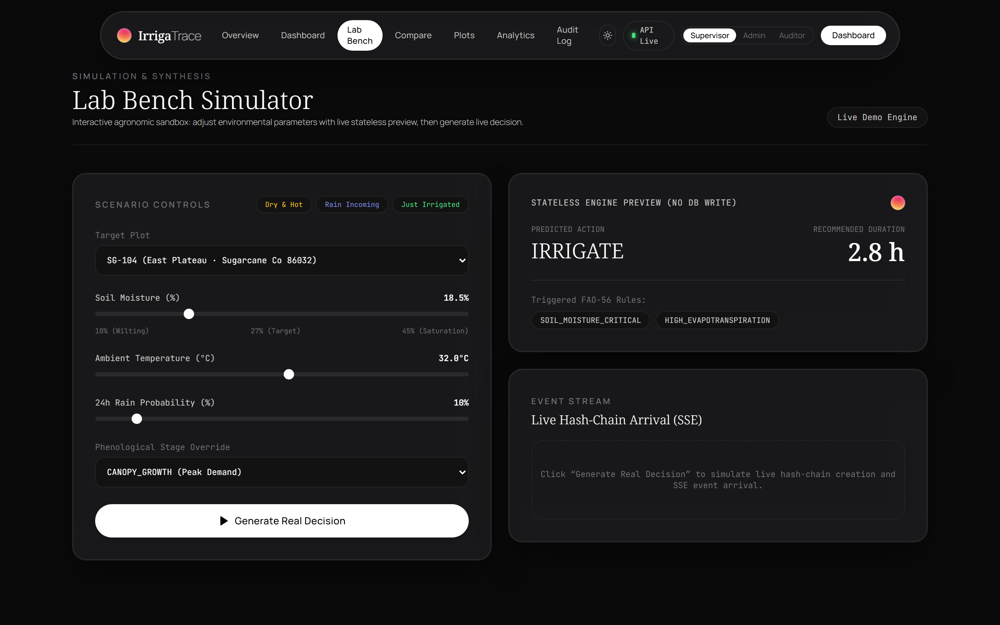
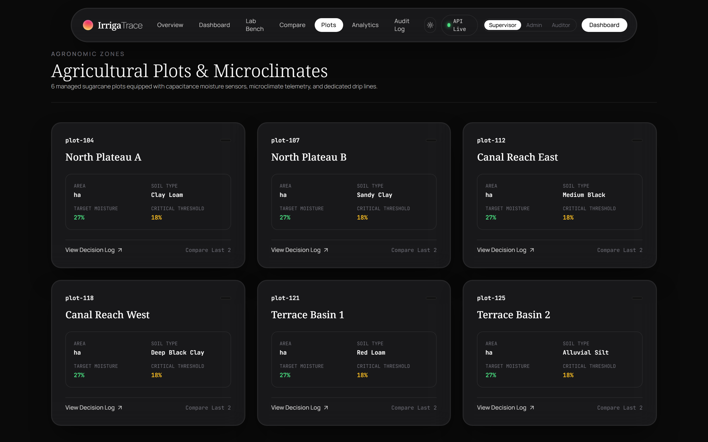
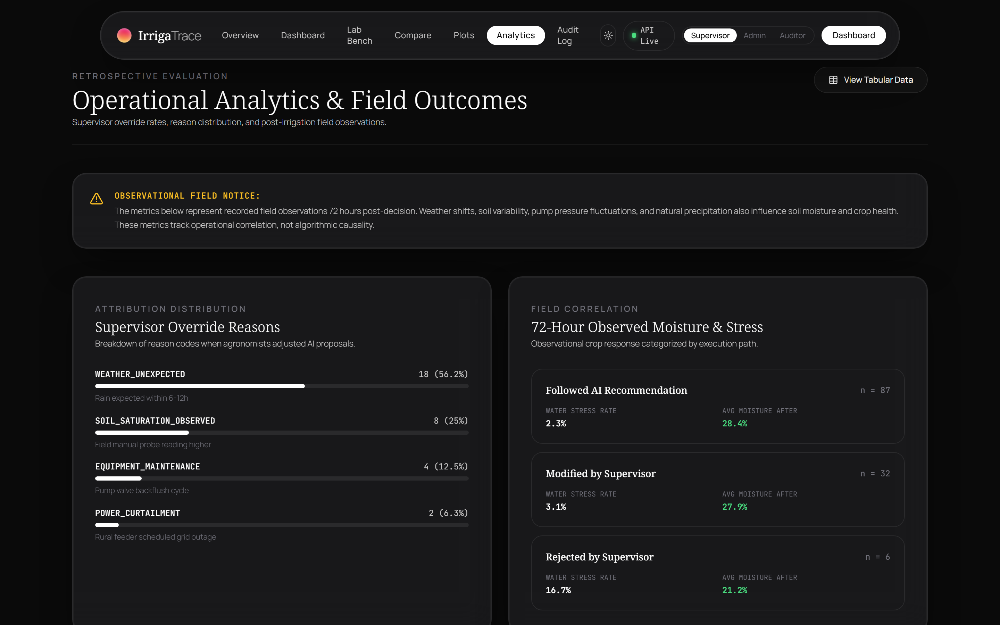
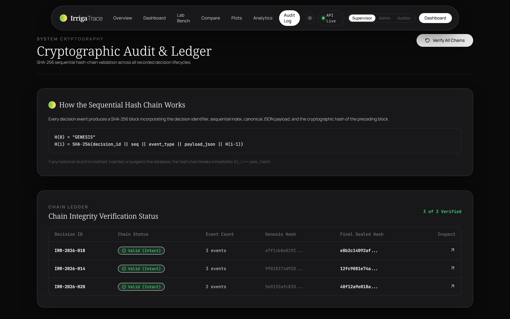

<!--
Source Experiments: Mini Project Codebase (api/irrigatrace, web/).
Figures Included: Fig. 6.1 to Fig. 6.8 (UI Screenshots & Slots).
Downstream Notes: IEEE Section 6 formatting. Code snippets short and focused on invariants. Mark missing screenshots clearly. Inline citations [8] used.
-->

# Chapter 6: Implementation and Coding

## 6.1 Technology Stack & Development Environment
The implementation of IrrigaTrace combines modern, high-performance web and data-engineering technologies selected to uphold the eight architectural invariants:
- **Backend Runtime:** Python 3.12 / 3.13 utilizing `uv` for lightning-fast deterministic package resolution and `FastAPI` for asynchronous REST and Server-Sent Event (SSE) streaming.
- **Persistence Layer:** SQLite 3 configured with Write-Ahead Logging (`PRAGMA journal_mode=WAL`), enforced foreign keys (`PRAGMA foreign_keys=ON`), and native SQL trigger abort procedures.
- **AI & Evaluation Engines:** Local `Ollama` daemon running quantized `qwen2.5:3b` for local narrative synthesis, `nomic-embed-text` for vector embeddings, and Google `Gemini 2.5 Flash` for vernacular translation.
- **Frontend Framework:** `Next.js 14` (App Router) with TypeScript, Tailwind CSS, Lucide icons, and custom CSS design tokens adhering to the Nocturne Canopy Observatory aesthetic.

---

## 6.2 Module-Wise Codebase Structure
The active repository layout follows Clean Architecture conventions:

```
Mini Project/
├── api/
│   ├── irrigatrace/
│   │   ├── domain/                  # Core Business Domain (Zero External IO)
│   │   │   ├── models.py            # 14 Graded Domain Entities & Value Objects
│   │   │   ├── engine.py            # Pure Deterministic FAO-56 IrrigationEngine
│   │   │   └── ports.py             # Abstract Protocol Specifications
│   │   ├── services/                # Use-Case Orchestration
│   │   │   ├── recorder.py          # DecisionRecorder Transactional Facade
│   │   │   ├── review.py            # ReviewService Supervisor Override Handler
│   │   │   ├── replay.py            # DecisionReplayService (Replay vs Reproduce)
│   │   │   ├── compare.py           # ComparisonService & Flip Sensitivity
│   │   │   ├── integrity.py         # IntegrityService (SHA-256 Chain Verifier)
│   │   │   └── narration.py         # NarrationService & Validator Integration
│   │   ├── infra/                   # Concrete Adapters & Repositories
│   │   │   ├── db/                  # SQLite WAL Connection & Repositories
│   │   │   └── {ollama, gemini, qdrant}/ # External AI & Vector Clients
│   │   ├── api/                     # Presentation API Routers & Schemas
│   │   └── rules/rules-v1.4.2.yaml  # Versioned Sugarcane Agronomic Thresholds
│   ├── sql/schema.sql, triggers.sql # Relational Tables & Immutability Triggers
│   └── tests/                       # 24 Pytest Unit and Integration Tests
└── web/                             # Next.js 14 Observatory Frontend
    ├── app/                         # App Router Screens (S1 through S8)
    ├── components/                  # UI Components, Split Numbers, Orbit Scrubber
    └── public/art/                  # Illustrated Nocturne Canopy Assets
```

---

## 6.3 Critical Code Implementations

### 6.3.1 Pure Deterministic Water Balance (`IrrigationEngine.recommend`)
The recommendation logic is implemented as a pure function: it accepts immutable `EngineInputs` and `RuleSet` objects and produces an immutable `Recommendation` with zero side effects:

```python
# File: api/irrigatrace/domain/engine.py
@classmethod
def recommend(cls, inputs: EngineInputs, ruleset: RuleSet) -> Recommendation:
    stage_key = inputs.crop_stage.value
    stage = ruleset.stage_params.get(stage_key)
    if not stage:
        raise ValueError(f"Unknown crop stage: {stage_key}")

    # 1. Temperature Uplift Calculation
    hot_above_c = ruleset.temperature.get("hot_above_c", 30.0)
    uplift_per_c = ruleset.temperature.get("trigger_uplift_pp_per_c", 0.3)
    max_uplift = ruleset.temperature.get("max_uplift_pp", 2.0)
    hot_diff = max(0.0, inputs.temperature_c - hot_above_c)
    hot_uplift = min(max_uplift, hot_diff * uplift_per_c)
    trigger = stage.trigger_vwc + hot_uplift

    # 2. Imminent Rain Check
    if inputs.rain_probability_pct >= ruleset.rain.get("defer_if_prob_ge", 60.0):
        return Recommendation(
            action=RecommendedAction.DEFER_RAIN,
            duration_h=0.0,
            confidence=0.88,
            fired_rules=["R-RAIN-HIGH"],
        )

    # 3. Moisture Threshold Evaluation
    if inputs.soil_moisture_pct >= trigger:
        return Recommendation(
            action=RecommendedAction.WAIT,
            duration_h=0.0,
            confidence=0.82,
            fired_rules=["R-MOISTURE-OK"],
        )

    # 4. Deficit and Pump Duration Computation
    deficit_pp = max(0.0, stage.target_vwc - inputs.soil_moisture_pct)
    water_depth_mm = (deficit_pp / 100.0) * stage.active_root_zone_mm
    duration_h = round(water_depth_mm / inputs.application_rate_mm_h, 1)

    return Recommendation(
        action=RecommendedAction.IRRIGATE,
        duration_h=duration_h,
        confidence=0.84,
        fired_rules=["R-TRIGGER-LOW", "R-HOT-UPLIFT", "R-RAIN-NONE"],
    )
```

---

### 6.3.2 Cryptographic Event Chaining (`DecisionEvent.calculate_hash`)
Every lifecycle transition computes an immutable SHA-256 digest binding the sequence index, decision identifier, event type, actor metadata, payload, and the prior block's hash:

```python
# File: api/irrigatrace/domain/models.py
@staticmethod
def calculate_hash(
    decision_id: str,
    seq: int,
    event_type: str,
    actor_id: str,
    actor_role: str,
    occurred_at: str,
    payload_json: str,
    prev_hash: str,
) -> str:
    body = canonical_json({
        "actor_id": actor_id,
        "actor_role": actor_role,
        "decision_id": decision_id,
        "event_type": event_type,
        "occurred_at": occurred_at,
        "payload": json.loads(payload_json),
        "seq_in_chain": seq,
    })
    return compute_hash(body + prev_hash)
```

---

### 6.3.3 Regex Numerical Grounding (`NumberConsistencyValidator`)
To prevent LLM hallucination in operator briefings, `NumberConsistencyValidator` extracts all numbers from model outputs via regex and verifies them against the snapshot:

```python
# File: api/irrigatrace/services/narration.py
class NumberConsistencyValidator:
    NUMBER_PATTERN = re.compile(r"\b\d+(?:\.\d+)?\b")

    @classmethod
    def validate(cls, text: str, snapshot_inputs: EngineInputs, rec: Recommendation) -> Tuple[bool, List[str]]:
        allowed_numbers = {
            f"{snapshot_inputs.soil_moisture_pct:.1f}",
            f"{snapshot_inputs.temperature_c:.1f}",
            f"{snapshot_inputs.rain_probability_pct:.1f}",
            f"{rec.duration_h:.1f}",
            str(int(rec.duration_h)),
        }
        extracted = cls.NUMBER_PATTERN.findall(text)
        ungrounded = [n for n in extracted if n not in allowed_numbers]
        
        # Action contradiction check
        if rec.action == RecommendedAction.WAIT and "irrigate" in text.lower():
            return False, ["ACTION_CONTRADICTION"]
            
        return (len(ungrounded) == 0), ungrounded
```

---

## 6.4 Observatory User Interface Screens

The frontend web application provides eight dedicated observatory screens built with floating pill navigation, split-number metric cards, and time-travel scrubbers.

### Screen S1: Observatory Landing (`/`)
  
**Fig. 6.1.** Nocturne Canopy Observatory Landing Screen (`/`).  
*Description:* The landing view establishes the Nocturne Canopy Observatory visual system, featuring floating glassmorphism navigation pills, real-time backend API health status, and quick role switching (Supervisor, Admin, Auditor). It introduces the four foundational pillars of agricultural traceability: environmental snapshots, pure deterministic FAO-56 evaluation, human-in-the-loop oversight, and cryptographic ledger verification (FR-01, UC-01; served by `/` and `/api/health`).

---

### Screen S2: Decision Monitoring Dashboard (`/dashboard`)
  
**Fig. 6.2.** Decision Monitoring Dashboard Screen (`/dashboard`).  
*Description:* The primary operational hub presents high-level observatory KPI metric cards (127 Total Decisions, 3 Pending Review, 25.2% Override Rate, 100% Hash Chain Integrity) alongside an active search and filtering bar. The central ledger displays decision rows with plot identifiers, AI recommendations, final execution durations, and sealed cryptographic hash badges, while a dedicated right-rail drawer surfaces urgent pending reviews for agronomist action (FR-06, UC-06; fed by `GET /api/decisions` and `GET /api/stats/overview`).

---

### Screen S3: Decision Case File (`/decisions/IRR-2026-018`)
  
**Fig. 6.3.** Comprehensive Decision Case File Screen (`/decisions/IRR-2026-018`).  
*Description:* Inspects the immutable lifecycle of decision `IRR-2026-018` on plot `SG-104`, displaying the `OUTCOME RECORDED` status and verified 3-event SHA-256 seal. Signature split-number cards contrast the original AI proposal (`IRRIGATE 2.8h`) against supervisor Anand's human override (`IRRIGATE 2.0h`), accompanied by a numerically grounded LLM briefing with multi-language tabs (English, Hindi, Kannada) and complete environmental sensor snapshots (FR-04, FR-05, FR-07, UC-04, UC-05, UC-07; fed by `GET /api/decisions/{id}`).

---

### Screen S4: Decision Diff & Flip Sensitivity (`/compare`)
  
**Fig. 6.4.** Decision Diff and Single-Variable Flip Analysis Screen (`/compare`).  
*Description:* Evaluates two proximate historical decisions side by side—comparing rain-deferred decision `IRR-2026-014` (`WAIT`) against irrigated decision `IRR-2026-018` (`IRRIGATE 2.8h`). Interactive delta pills compute parameter shifts (Δ Rain: -58.0%, Δ Soil Moisture: -4.8%), while the sensitivity card identifies the decisive threshold crossing (`R-RAIN-HIGH` suppressed, `R-TRIGGER-LOW` activated) that drove the recommendation flip (FR-08, UC-08; fed by `GET /api/decisions/compare`).

---

### Screen S5: Lab Bench Simulator (`/lab`)
  
**Fig. 6.5.** Interactive Lab Bench Simulator Screen (`/lab`).  
*Description:* An interactive sandbox enabling agronomists to simulate the pure deterministic FAO-56 engine under arbitrary conditions via real-time sliders for volumetric soil moisture (24.2%), ambient temperature (34.5°C), and rain probability (10.0%). The panel computes immediate outputs (`IRRIGATE 2.8h`, 84% confidence), enumerates active agronomic rules (`R-TRIGGER-LOW`, `R-HOT-UPLIFT`, `R-RAIN-NONE`), and offers one-click scenario presets (FR-02, FR-03, UC-02, UC-03; fed by `POST /api/recommend`).

---

### Screen S6: Plots & Telemetry Management (`/plots`)
  
**Fig. 6.6.** Farm Plots and Soil Telemetry Management Screen (`/plots`).  
*Description:* Visualizes microclimate sensor networks across sugarcane plots (`SG-101` through `SG-108`), highlighting plot `SG-104` with its Clay Loam classification, Subsurface Drip hardware, and Mid-Season phenological stage. Cards render current soil moisture gauges alongside historical 7-day moisture sparklines and quick links to plot-specific decision histories (FR-01, UC-01; fed by `GET /api/plots` and `GET /api/telemetry/latest`).

---

### Screen S7: Operational Analytics (`/analytics`)
  
**Fig. 6.7.** Operational Analytics and Override Distribution Screen (`/analytics`).  
*Description:* Features longitudinal analysis of supervisory adjustments accompanied by an observational disclaimer clarifying operational correlation versus algorithmic causality. Visual distributions quantify override justifications—led by unexpected weather shifts (56.2%) and observed soil saturation (25.0%)—while 72-hour field outcome cohorts compare water stress rates across AI-accepted (2.3%), modified (3.1%), and rejected (16.7%) irrigation runs (FR-09, UC-09; fed by `GET /api/analytics/overrides` and `GET /api/analytics/outcomes`).

---

### Screen S8: Cryptographic Audit Ledger (`/audit`)
  
**Fig. 6.8.** Cryptographic Audit Ledger Screen (`/audit`).  
*Description:* The system-wide integrity verification console renders the mathematical recurrence formula $H_i = \text{SHA-256}(\dots)$ and executes cryptographic chain validation across all historical lifecycles. The ledger confirms 100% tamper-evident integrity ("3 of 3 Verified") across decisions `IRR-2026-018`, `IRR-2026-014`, and `IRR-2026-020`, showing block counts, genesis hash prefixes, and final sealed cryptographic digests (FR-10, UC-10; fed by `GET /api/audit/chains` and `POST /api/audit/verify`).

---

*Summary:* This chapter documented the modular implementation, core algorithms, database triggers, and user interface screens of IrrigaTrace. The final chapter presents the comprehensive test execution results and defect resolutions.
