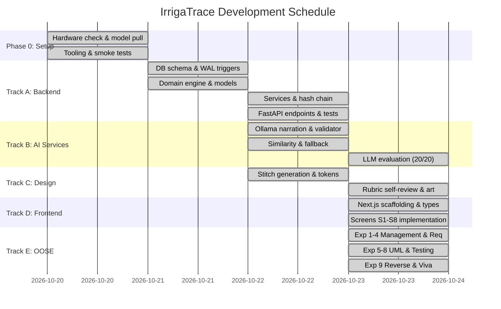

# Experiment 2: Software Project Management Plan (SPMP) (Corrected)

**Course:** Object-Oriented Software Engineering (OOSE Lab, Semester 5)  
**Standard:** IEEE Std 1058-1998  
**Project Code:** KJS-AGR-01  
**Project Title:** IrrigaTrace: Audit, Replay, and Traceability Framework for AI Irrigation Decisions  
**Institution:** K. J. Somaiya College of Engineering (KJSCE), Somaiya Vidyavihar University  
**Student:** Yoosha Abbas (Roll No.: 16014224101, Batch: B2)  
**Date:** 2026-10-23  
**Course Outcome:** CO2  

---

## 1. Work Breakdown Structure (WBS)
The project deliverables are organized into five concurrent work tracks:
- **Track A (Backend Core):** Schema & WAL triggers, pure FAO-56 engine, repositories, services (Recorder, Review, Replay, Compare, Integrity), FastAPI endpoints.
- **Track B (AI Services):** Ollama narration strategy, `NumberConsistencyValidator`, Gemini translation, Qdrant vector indexer with SQL fallback.
- **Track C (Design System & Stitch):** Nocturne Canopy tokens, Stitch screen generation (S1–S8), self-review rubric (100 pts), illustrated art assets.
- **Track D (Frontend Web Application):** Next.js App Router, floating pill navigation, orbit timeline with scrubber, AI-vs-Human split numbers, Lab Bench simulator.
- **Track E (Quality Assurance & OOSE Deliverables):** Academic documentation, UML behavioral/structural models, STD test registers (24 tests), Viva defense guide.

---

## 2. Project Schedule (Gantt Chart Representation)

---

## 3. Software Effort & Size Estimation (Audited Arithmetic)

### 3.1 Function Point (FP) Analysis
Based on IFPUG Function Point Counting Practices Manual (CPM 4.3.1) standards:
- **External Inputs (EI):** 8 inputs (Sensor reading ingest, human review submission, outcome recording, scenario slider inputs, plot creation, ruleset update, compare query, reproduce trigger). Weight: Average (4).
  $$\text{EI Points} = 8 \times 4 = 32$$
- **External Outputs (EO):** 6 outputs (Recommendation generation, hash-chain proof verification, flip analysis matrix, SSE event stream, reproduce diff report, PDF/JSON audit export). Weight: High (6).
  $$\text{EO Points} = 6 \times 6 = 36$$
- **External Inquiries (EQ):** 5 inquiries (Decision case file query, plot telemetry lookup, KPI aggregate summary, similar decisions search, audit status). Weight: Low (3).
  $$\text{EQ Points} = 5 \times 3 = 15$$
- **Internal Logical Files (ILF):** 5 files (`farm_plots`, `decision_snapshots`, `human_reviews`, `decision_events`, `outcome_records`). Weight: Average (10).
  $$\text{ILF Points} = 5 \times 10 = 50$$
- **External Interface Files (EIF):** 3 interfaces (Ollama local API, Gemini translation API, Qdrant Cloud API). Weight: Average (7).
  $$\text{EIF Points} = 3 \times 7 = 21$$

Sum of Unadjusted Function Points:
$$\text{UFP} = 32 + 36 + 15 + 50 + 21 = 154\text{ FP} \tag{1}$$

Evaluating the 14 General System Characteristics (Total Degree of Influence $\sum c_i = 35$):
$$\text{VAF} = 0.65 + (0.01 \times 35) = 1.00 \tag{2}$$
$$\text{AFP} = \text{UFP} \times \text{VAF} = 154 \times 1.00 = 154\text{ FP} \tag{3}$$

### 3.2 COCOMO-Basic Effort & Schedule Estimation
Converting 154 FP to Python/TypeScript Lines of Code (conversion factor $\approx 50$ SLOC/FP):
$$\text{Estimated Size} = 154 \times 50 = 7,700\text{ SLOC} = 7.7\text{ KLOC}$$

Using Boehm’s **Organic Mode** COCOMO equations:
$$E = a \times (\text{KLOC})^b = 2.4 \times (7.7)^{1.05} \tag{4}$$
Evaluating $(7.7)^{1.05} \approx 8.5273$:
$$E = 2.4 \times 8.5273 = 20.47\text{ Person-Months}$$

The nominal development schedule $T_{\text{dev}}$ is:
$$T_{\text{dev}} = c \times (E)^d = 2.5 \times (20.47)^{0.38} \tag{5}$$
Evaluating $(20.47)^{0.38} \approx 3.1493$:
$$T_{\text{dev}} = 2.5 \times 3.1493 = 7.87\text{ Months}$$

The average staffing requirement $N$ is:
$$N = \frac{E}{T_{\text{dev}}} = \frac{20.47\text{ PM}}{7.87\text{ Months}} \approx 2.60 \approx 3\text{ Engineers} \tag{6}$$

---

## 4. Risk Management Register

| Risk ID | Description | Likelihood | Impact | Severity | Mitigation Strategy |
|---|---|---|---|---|---|
| **R-01** | Local Ollama LLM hallucinating values | Medium | High | **Critical** | `NumberConsistencyValidator` regex grounding check; fallback to `TemplateNarrationStrategy`. |
| **R-02** | External Qdrant Cloud network timeout (IPv4) | High | Medium | **High** | Invariant 8 fallback: deterministic SQL nearest-neighbor calculation. |
| **R-03** | Unauthorized mutation of past recommendation | Low | Catastrophic | **Critical** | Database-level SQLite trigger `dec_core_immutable` + SHA-256 tamper-evident hash chain. |
| **R-04** | SQLite concurrency bottlenecks | Low | Medium | **Medium** | Enable Write-Ahead Logging (`PRAGMA journal_mode=WAL`) on all connections. |
| **R-05** | CSS styling slop / generic dashboard look | Medium | High | **High** | Enforce `design-taste-frontend` rules and strict 100-pt rubric self-review. |

---

## 5. Team Roles & Organizational Structure
- **Product Manager & Agronomic Lead:** Defines FAO-56 business rules, sugarcane stage thresholds, and user persona stories.
- **Backend & Database Engineer:** Implements SQLite triggers, WAL connection pooling, domain models, and FastAPI routes.
- **AI & Evaluation Engineer:** Configures local Ollama models, prompt engineering, Gemini translations, and validation test harnesses.
- **Frontend & UI/UX Engineer:** Restyles components, implements orbit scrubber, responsive layouts, and parallax artwork.
- **Quality Assurance & Compliance Lead:** Maintains traceability matrix, executes Pytest suites, runs Playwright E2E tests.
