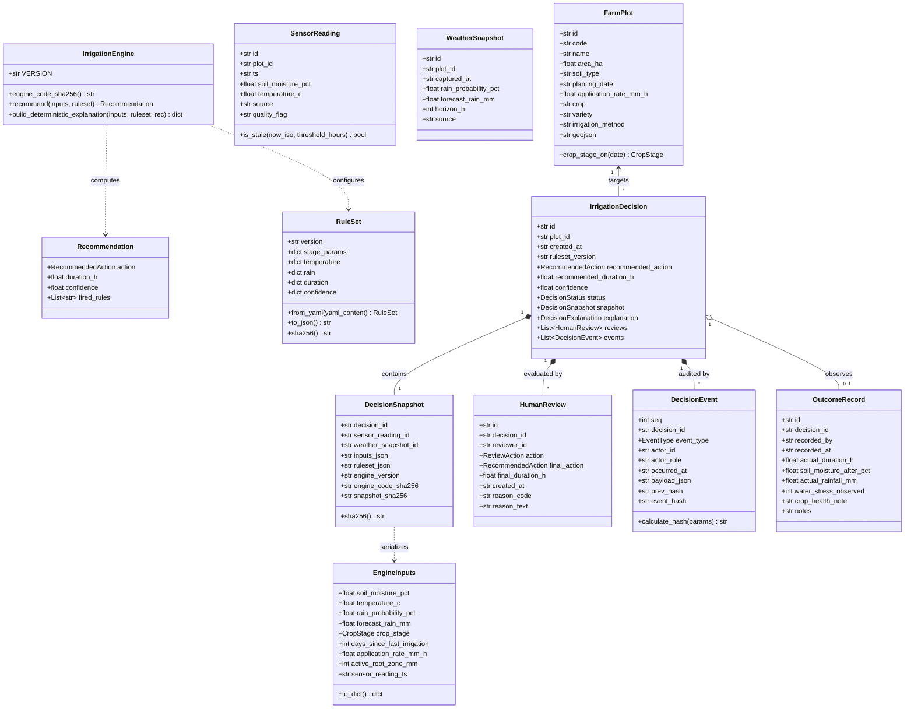
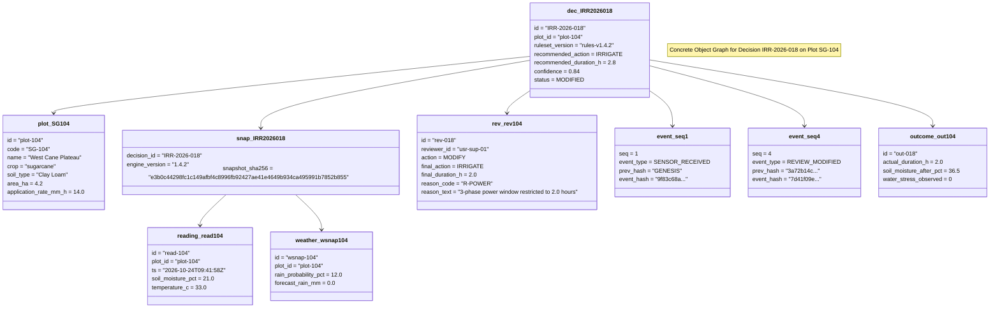
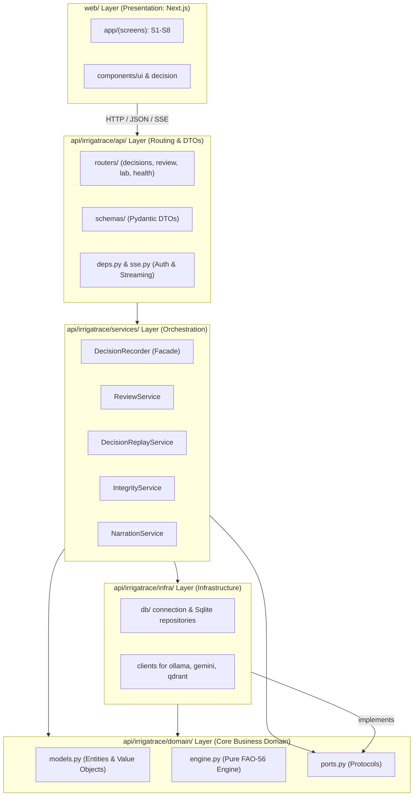
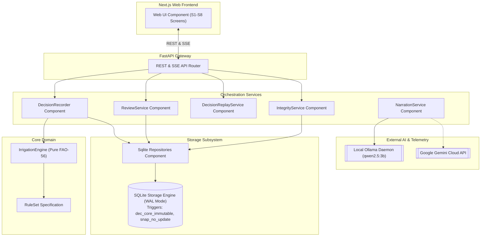
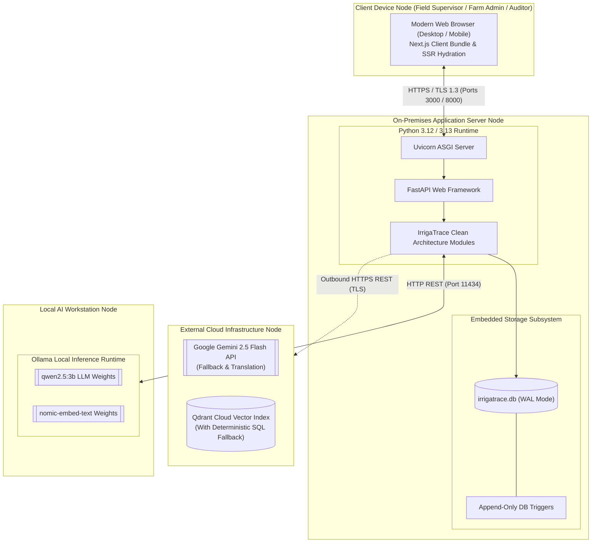

# Experiment 6: Structural UML Modeling (Corrected)

**Course:** Object-Oriented Software Engineering (OOSE Lab, Semester 5)  
**Project Code:** KJS-AGR-01  
**Project Title:** IrrigaTrace: Audit, Replay, and Traceability Framework for AI Irrigation Decisions  
**Institution:** K. J. Somaiya College of Engineering (KJSCE), Somaiya Vidyavihar University  
**Student:** Yoosha Abbas (Roll No.: 16014224101, Batch: B2)  
**Date:** 2026-10-23  
**Course Outcome:** CO3  

---

## 1. Domain Class Diagram (14 Core Entities)
*Generated directly from active codebase AST (`api/irrigatrace/domain/models.py` & `engine.py`).*

---

## 2. Concrete Object Diagram (Instance IRR-2026-018 on Plot SG-104)

---

## 3. Package, Component, and Deployment Diagrams

### 3.1 Package Diagram (Layered Dependencies)

### 3.2 Component Diagram

### 3.3 Deployment Diagram

