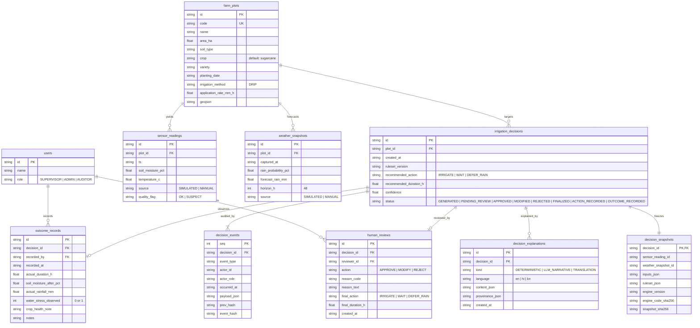

# Experiment 7: System Design Document (SDD) (Corrected)

**Course:** Object-Oriented Software Engineering (OOSE Lab, Semester 5)  
**Standard:** IEEE Std 1016-2009  
**Project Code:** KJS-AGR-01  
**Project Title:** IrrigaTrace: Audit, Replay, and Traceability Framework for AI Irrigation Decisions  
**Institution:** K. J. Somaiya College of Engineering (KJSCE), Somaiya Vidyavihar University  
**Student:** Yoosha Abbas (Roll No.: 16014224101, Batch: B2)  
**Date:** 2026-10-23  
**Course Outcome:** CO3  

---

## 1. Architectural Overview & Style
IrrigaTrace adheres to a **Clean Hexagonal / Layered Architecture** with strict decoupling between Domain, Service, Infrastructure, and Presentation layers:
1. **Domain Layer (`api/irrigatrace/domain`):** Pure functional agronomic entities and calculations (`IrrigationEngine`, `models.py`). Zero third-party I/O or network dependencies.
2. **Service Layer (`api/irrigatrace/services`):** Use-case orchestration (`DecisionRecorder`, `ReviewService`, `DecisionReplayService`, `IntegrityService`, `NarrationService`).
3. **Infrastructure Layer (`api/irrigatrace/infra`):** SQLite connection pool with WAL mode, append-only triggers, repository implementations, and external LLM/vector clients.
4. **Presentation Layer (`api/irrigatrace/api` & `web`):** FastAPI REST/SSE endpoints and Next.js frontend observatory interface.

---

## 2. Data Design: Entity-Relationship Diagram (ERD)

---

## 3. Detailed Design Patterns & Class References

| Design Pattern | Purpose in IrrigaTrace | Active Class References in Code |
|---|---|---|
| **Strategy Pattern** | Pluggable LLM narration generation with automatic template fallback. | `NarrationStrategy`, `OllamaNarrationStrategy`, `GeminiNarrationStrategy`, `TemplateNarrationStrategy`. |
| **Repository Pattern** | Persistence abstraction isolating domain logic from SQLite SQL syntax. | `PlotRepository`, `SensorRepository`, `DecisionRepository` protocols implemented by `SqliteDecisionRepository`, etc. |
| **State Pattern** | Decision lifecycle state management and illegal transition prevention. | `DecisionStatus` enumeration and state machine projection checks in `ReviewService`. |
| **Factory Pattern** | Encapsulated instantiation of decisions and versioned rulesets. | `DecisionFactory.from_inputs()` and `RuleSet.from_yaml()`. |
| **Observer Pattern** | Asynchronous event distribution to SSE web streams and Qdrant indexers. | `EventPublisher` protocol broadcasting `DecisionEvent` payloads. |
| **Value Object Pattern** | Immutability and structural equality for measurements and calculations. | `@dataclass(frozen=True)` classes: `Recommendation`, `EngineInputs`, `SensorReading`, `WeatherSnapshot`. |
| **Facade Pattern** | Unified, atomic transactional entry point for decision generation. | `DecisionRecorder.record_decision()`. |

---

## 4. SQLite Storage Engine Invariants & Triggers
The SQLite storage engine enforces immutability via database-level triggers declared in `api/sql/triggers.sql`:
- `dec_core_immutable`: Aborts any attempt to modify original recommendation columns on `irrigation_decisions`.
- `dec_no_delete`: Aborts any attempt to delete historical decisions.
- `snap_no_update`, `snap_no_delete`: Enforces permanent immutability on input snapshots.
- `events_no_update`, `events_no_delete`: Enforces append-only constraints on the audit ledger.
- `rev_no_update`, `rev_no_delete`: Guarantees human review adjustments cannot be retroactively tampered with.
